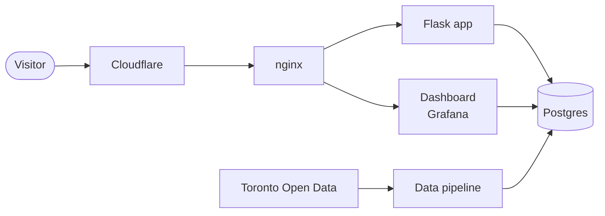
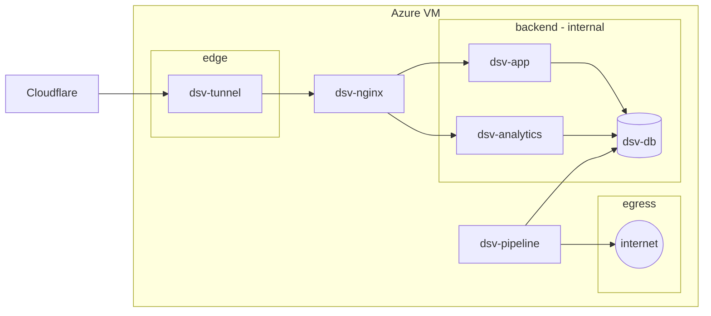

# App architecture

This document describes how the DineSafeViz application works and its tech stack.

## Overview

DineSafeViz is a Docker Compose application hosted on an Azure VM. A Flask
app serves the web pages, and Grafana serves an analytics dashboard. Both read
the same Postgres database, and nginx sits in front of both. A data pipeline
loads the City of Toronto's DineSafe inspections into the database.

Visitors never connect to the VM directly. No port is published, and the tunnel only makes outbound connections.

nginx sends `/analytics/` to Grafana and everything else to the app. It
re-resolves the container names every 5 seconds, so a recreated container
with a new IP address doesn't cause 502 errors.

`dsv-app` and `dsv-analytics` connect as the read-only `dinesafe_app` role,
which caps every query at 10 seconds. Visitors see Grafana as anonymous
viewers. On the VMs, nginx returns 404 for `/analytics/login`, so Grafana
admins sign in through an SSH tunnel to `172.30.10.30:3000` instead. For the
admin path over SSH and the network rules, see

The Flask app (`src/dsv-app/app.py`) serves these routes:

| Route                 | Page                                                                                       |
| --------------------- | ------------------------------------------------------------------------------------------ |
| `/`                   | Home page with the total number of inspections and the years of data.                     |
| `/inspections`        | Inspections for one quarter (`?year=&q=`), grouped by day and establishment.              |
| `/inspections/month`  | One month's inspections as an HTML fragment, loaded when you expand an older month.       |
| `/dashboard`          | The Grafana dashboard in an iframe (`/analytics/d/dinesafe/dinesafe-inspections?kiosk`). |
| `/info`               | What the severities and results mean.                                                      |
| `/healthz`, `/readyz` | Liveness, and readiness, which checks the database connection.                             |

Gunicorn runs the app with one worker and four threads.

## Services

Every component runs as a Docker Compose service. `docker-compose.yml`
defines the local stack, and `docker-compose.vm.yml` adds the VM settings:
published images, networks, hardening, and memory limits.

| Service         | Image                                 | Networks (VM)       | Memory (VM) | Role                                                       |
| --------------- | ------------------------------------- | ------------------- | ----------- | ---------------------------------------------------------- |
| `dsv-tunnel`    | `cloudflare/cloudflared:2026.10.0`    | `edge`              | 64 MiB      | Outbound tunnel to Cloudflare. VM only.                    |
| `dsv-nginx`     | `nginx:1.31.0-alpine-slim`            | `edge`, `backend`   | 64 MiB      | Reverse proxy for the app and `/analytics/`.               |
| `dsv-app`       | `ghcr.io/im-kenough/dsv-app`          | `backend`           | 192 MiB     | Flask app. Read-only database role.                        |
| `dsv-db`        | `postgres:18.6-alpine3.24`            | `backend`           | 320 MiB     | Postgres with the `inspections` and `load_log` tables.     |
| `dsv-analytics` | `grafana/grafana:13.2.3`              | `backend`           | 320 MiB     | Dashboard. Read-only database role.                        |
| `dsv-pipeline`  | `ghcr.io/im-kenough/dsv-init-db`      | `egress`, `backend` | 768 MiB     | On demand: `ingest`, `load`, or `run`. Profile `pipeline`. |

Locally, Compose builds `dsv-app` and `dsv-pipeline` from `src/dsv-app` and
`src/dsv-db`, and every service shares the default network. On the VMs, the
two app images come from GHCR, pinned to the deployed version's tag (set by
`scripts/deploy.sh` as `DSV_VERSION`). Every service sets `no-new-privileges`
and rotates its logs. Every service except `dsv-analytics` drops all Linux
capabilities and adds back only the ones it needs. `dsv-tunnel`, `dsv-app`,
and `dsv-pipeline` also run with a read-only root filesystem.

`dsv-pipeline` has the `pipeline` profile, so `docker compose up` never
starts it. Only `scripts/pipeline.sh` runs it.

## Networks on the VM

On the VMs, each container joins one or more of three Docker networks.
Nothing publishes a port on the VM, so visitors reach the site only through
the Cloudflare Tunnel.

- `edge` connects `dsv-tunnel` to Cloudflare and to `dsv-nginx`.
- `backend` is internal: its containers can't reach the internet or the Azure
  instance metadata service.
- `egress` gives `dsv-pipeline` internet access to download from Toronto Open
  Data and the storage account.

`dsv-nginx` and `dsv-pipeline` are the only containers on two networks, so
they're the only paths between `backend` and the outside.
