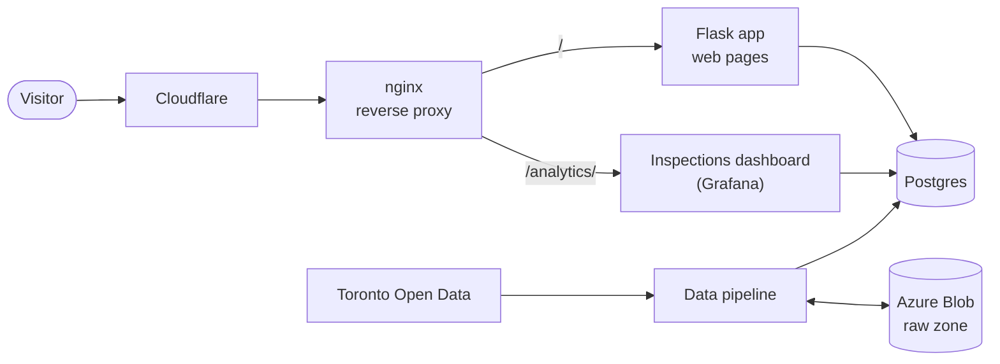
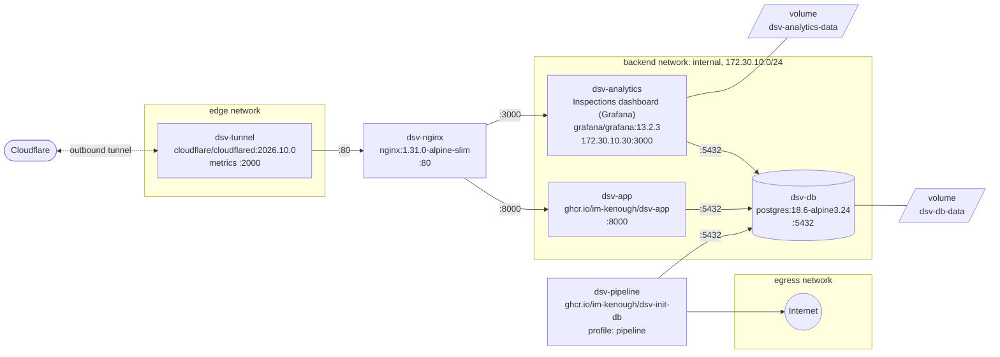

# App architecture

How DineSafeViz works and what it runs on.

## Overview

DineSafeViz shows the City of Toronto's DineSafe restaurant inspections.

- Runs as a Docker Compose stack on an Azure VM.
- Cloudflare Tunnel brings visitors in. The VM publishes no ports.
- nginx routes `/analytics/` to the inspections dashboard (Grafana) and
  everything else to the Flask app.
- The Flask app and the inspections dashboard (Grafana) read the same Postgres
  database. The dashboard shows statistics about the dataset, not monitoring.
- A data pipeline, on a weekday timer or on demand, loads the data:
  Toronto Open Data → Azure Blob raw zone → Postgres.

## Flask app

The Flask app is `src/dsv-app/app.py`. Gunicorn runs it with 1 worker and 4
threads on port 8000.

| Route                | Returns                                                                                                |
| -------------------- | ------------------------------------------------------------------------------------------------------ |
| `/`                  | Home page with total inspections and years of data.                                                    |
| `/inspections`       | One quarter (`?year=&q=`), grouped by day and establishment.                                           |
| `/inspections/month` | One month as an HTML fragment, loaded when you expand an older month.                                  |
| `/dashboard`         | The inspections dashboard (Grafana) in an iframe (`/analytics/d/dinesafe/dinesafe-inspections?kiosk`). |
| `/info`              | What the severities and results mean.                                                                  |
| `/healthz`           | Liveness.                                                                                              |
| `/readyz`            | Readiness. Checks the database connection.                                                             |

## Access

Each service connects to Postgres with its own role. The inspections dashboard
(Grafana) has separate paths for visitors and admins.

| Who                        | Connects to                     | As                  | Access                                                     |
| -------------------------- | ------------------------------- | ------------------- | ---------------------------------------------------------- |
| `dsv-app`, `dsv-analytics` | Postgres                        | `dinesafe_app`      | `SELECT` only. 10-second `statement_timeout`.              |
| `dsv-pipeline`             | Postgres                        | `dinesafe_migrator` | Writes `inspections` and `load_log`.                       |
| Visitors                   | Inspections dashboard (Grafana) | Anonymous viewer    | Through nginx. On the VMs, `/analytics/login` returns 404. |
| Admins                     | Inspections dashboard (Grafana) | Admin               | SSH tunnel to `172.30.10.30:3000`.                         |

## Compose services

The diagram shows the stack on the VM: `docker-compose.yml` merged with
`docker-compose.vm.yml`. The labels on the arrows are the target ports.

| Service         | Networks (VM)       | Memory (VM) | Notes                                        |
| --------------- | ------------------- | ----------- | -------------------------------------------- |
| `dsv-tunnel`    | `edge`              | 64 MiB      | VM only. Token from `TUNNEL_TOKEN`.          |
| `dsv-nginx`     | `edge`, `backend`   | 64 MiB      | Re-resolves container names every 5 seconds. |
| `dsv-app`       | `backend`           | 192 MiB     | Runs as `nonroot`.                           |
| `dsv-db`        | `backend`           | 320 MiB     | Data in the `dsv-db-data` volume.            |
| `dsv-analytics` | `backend`           | 320 MiB     | Fixed IP for the admin SSH tunnel.           |
| `dsv-pipeline`  | `egress`, `backend` | 768 MiB     | `ingest`, `load`, or `run`. One-shot.        |

- Locally:
  - Compose builds `dsv-app` and `dsv-pipeline` from `src/dsv-app` and
    `src/dsv-db`.
  - All services share the default network.
  - nginx is published on `8080` and the inspections dashboard (Grafana) on
    `3000`.
- On the VMs:
  - Both app images come from GHCR, tagged with `DSV_VERSION` from
    `scripts/deploy.sh`.
  - `ports: !reset []` removes every published port.
- Startup order:
  - `dsv-db` → `dsv-app` and `dsv-analytics` → `dsv-nginx` → `dsv-tunnel`.
  - Each step waits for the previous health check, except `dsv-tunnel`.
- `dsv-pipeline`:
  - Its `pipeline` profile keeps `docker compose up` from starting it.
  - Only `scripts/pipeline.sh` runs it.

## Networks and hardening

The VM override splits the services across three networks and hardens every
container.

- `edge`: cloudflared's outbound connection, and its link to nginx.
- `backend`: internal. No route to the internet or the Azure instance metadata
  service.
- `egress`: lets `dsv-pipeline` reach Toronto Open Data and the storage
  account.
- `dsv-nginx` and `dsv-pipeline` are the only paths between `backend` and the
  outside.
- Every service:
  - sets `no-new-privileges`
  - rotates its logs (3 files of 10 MB each)
  - has a memory limit
- Every service except `dsv-analytics` drops all Linux capabilities and adds
  back only the ones it needs.
- `dsv-tunnel`, `dsv-app`, and `dsv-pipeline` run with a read-only root
  filesystem and a `/tmp` tmpfs.
