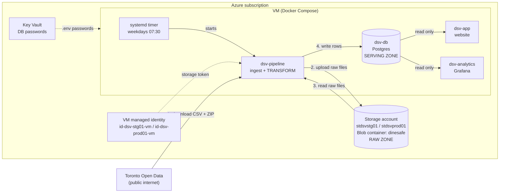
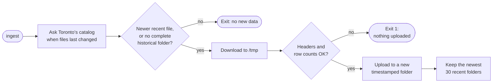
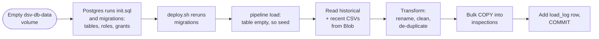
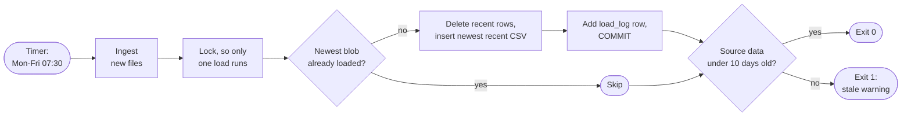

# Data architecture

This page gives a high-level view of how DineSafe inspection data moves from
Toronto Open Data into Postgres and stays current. Each section links to a
sub-document with the implementation details.

## Infrastructure

The data path has three zones: raw files in Azure Blob Storage, a temporary
transform step, and the Postgres database the site reads. One service,
`dsv-pipeline`, writes data. Everything else only reads.

| Component       | Pulls                    | Transforms          | Stores                          |
| --------------- | ------------------------ | ------------------- | ------------------------------- |
| `dsv-pipeline`  | Toronto Open Data, Blob  | Yes, in memory      | Nothing. One-shot container.    |
| Blob `dinesafe` | —                        | No                  | Raw files, as downloaded        |
| `dsv-db`        | —                        | No                  | `inspections` and `load_log`    |
| `dsv-app`       | `dsv-db`                 | No                  | A small stats cache, in memory  |
| `dsv-analytics` | `dsv-db`                 | No                  | Nothing                         |

- Same layout in stg and prod. Dev reads stg's storage, read-only.
- Only `dsv-pipeline` can reach the internet. The app and Grafana can't.
- The raw zone is the backup: it can rebuild the database without Toronto.
- `docker compose up` and restarts never change data.

For details, see [App architecture](2-app-architecture.md),
[Data operations](3-7-data-operations.md#access-and-credentials), and
[Data readers](3-9-data-readers.md).

## How raw data is ingested

Ingest copies new files from Toronto Open Data to Blob Storage. It never
touches the database.

- Two source files:
  - **Recent:** `Dinesafe.csv`, November 2023 to today. Updated often.
  - **Historical:** a ZIP of yearly CSVs, 2001 to 2023. Downloaded once.
- Each ingest writes a new folder. Existing files are never overwritten.
- A bad download is rejected before upload, so the raw zone only holds files
  that passed validation.
- Uses the VM's managed identity. No storage keys.

For details, see [Data sources](3-2-data-sources.md) and
[Data ingest](3-8-data-ingest.md).

## How the database is created and populated

Postgres creates the empty schema on first start. The pipeline then fills it
from the raw zone. This first fill is called a *seed*.

- Two tables:
  - `inspections`: one row per infraction, about 508,000 rows.
  - `load_log`: one row per successful load.
- Three database roles, each with least access:
  - Superuser: creates the schema only.
  - `dinesafe_migrator`: the pipeline. Read, insert, and delete.
  - `dinesafe_app`: the app and Grafana. Read only.
- The seed is one transaction. If it fails, the table stays empty and the
  deploy fails.
- Every deploy runs the load step. On an existing database it refreshes or
  skips instead of seeding.

For details, see [Database](3-5-database.md) and
[Data mapping](3-6-data-mapping.md).

## How the data is updated

A systemd timer runs the pipeline on weekday mornings. Each run ingests new
files, then replaces the recent rows in the database.

- Only the recent window is replaced. Historical rows are loaded once and
  never touched again.
- The swap is atomic: visitors see the old data until `COMMIT`, then the new
  data. No downtime.
- Any failure rolls back, and the site keeps serving the last good load.
- If Toronto Open Data is down, the data only gets older. Nothing breaks.
- Check the last run with `systemctl status dsv-pipeline.service`.

For details, see [Data operations](3-7-data-operations.md).
