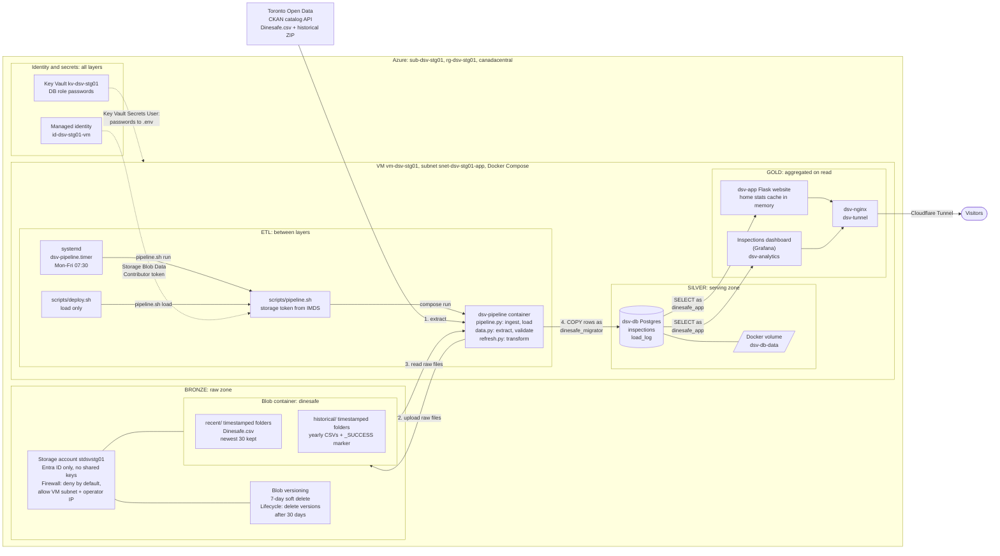
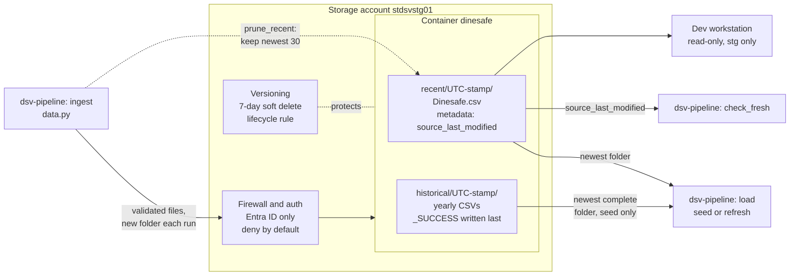
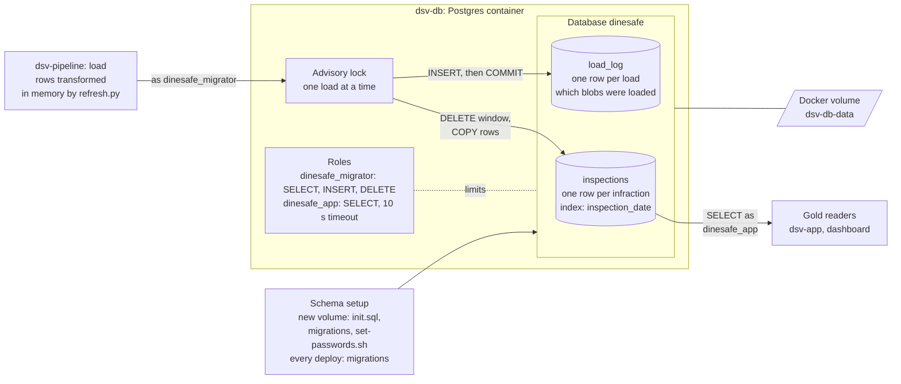
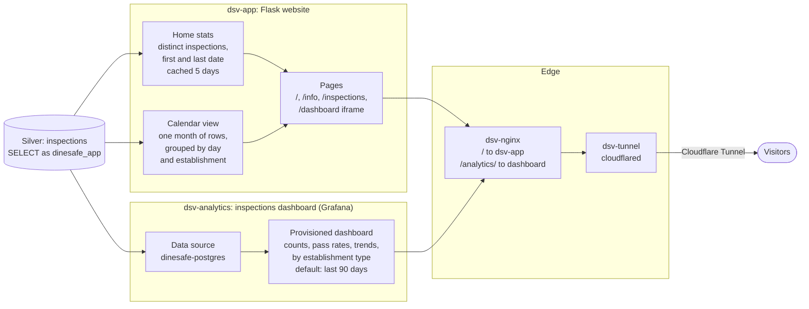
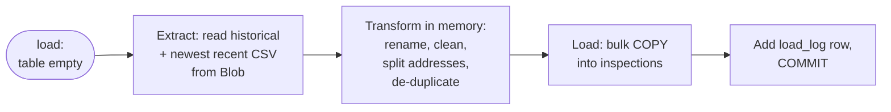
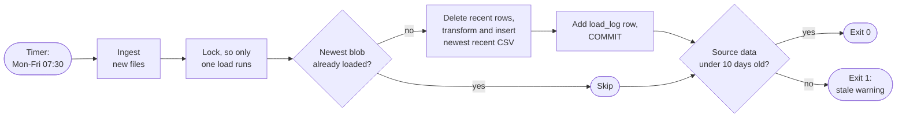

# Data architecture

This page gives a high-level view of how DineSafeViz stores, moves, and serves
DineSafe inspection data. It covers...

- **Layers:** where the data lives, and what state it's in.
- **Pipelines:** how data moves between the layers.
- **Operational events:** what happens to each layer when you deploy, redeploy,
  or restart the app.

## Overview

DineSafeViz adapts the
[medallion architecture](https://learn.microsoft.com/azure/databricks/lakehouse/medallion), sorting data into layers, with each layer more refined.

| Medallion layer | Function                                  | DineSafeViz Component                                                                   |
| --------------- | ----------------------------------------- | ----------------------------------------------------------------------------- |
| Bronze          | Raw data, exactly as the source sent it   | Azure Blob container `dinesafe`, the *raw zone*                                     |
| Silver          | Cleaned, validated, de-duplicated rows    | Postgres `inspections` table, the *serving zone*                              |
| Gold            | Aggregated, ready for a specific consumer | Not stored. The app and the inspections dashboard (Grafana) aggregate on read |

Modifications:

- **Two stored layers, not three.** Silver and gold share one Postgres
  database. At about 508,000 rows, query-time aggregation is fast enough, so a
  separate gold table isn't needed.
- **ETL, not ELT.** Lakehouses usually transform data inside the platform that
  stores it. DineSafeViz transforms data in the `dsv-pipeline` container, then
  loads finished rows into Postgres. Postgres never transforms data.

## Infrastructure

DineSafeViz modified medallion architecture.

| Component                             | Layer  | Pulls                   | Transforms             | Stores                         |
| ------------------------------------- | ------ | ----------------------- | ---------------------- | ------------------------------ |
| Storage account, container `dinesafe` | Bronze | —                       | No                     | Raw files, as downloaded       |
| `dsv-pipeline`                        | ETL    | Toronto Open Data, Blob | Yes, in memory         | Nothing. One-shot container.   |
| `dsv-db`, volume `dsv-db-data`        | Silver | —                       | No                     | `inspections` and `load_log`   |
| `dsv-app`                             | Gold   | `dsv-db`                | Aggregates per request | A small stats cache, in memory |
| Inspections dashboard (Grafana)       | Gold   | `dsv-db`                | Aggregates per request | Nothing                        |
| Managed identity, Key Vault           | All    | —                       | No                     | DB passwords (Key Vault)       |

- Dev has no Azure resources of its own: it reads stg's raw zone, read-only,
  and runs the rest on your workstation.
- Only `dsv-pipeline` can reach the internet. The app and the inspections
  dashboard (Grafana) can't.
- Only the VM's managed identity can write to Blob. There are no storage keys.
- Containers can't reach IMDS. `scripts/pipeline.sh` gets the storage token on
  the host and mounts it into the container.
- The inspections dashboard (Grafana) shows statistics about the dataset. It
  isn't used to monitor the app or the VM.

For details, see [App architecture](2-app-architecture.md),
[Data operations](3-7-data-operations.md#access-and-credentials), and
[Data readers](3-9-data-readers.md).

## Layers

### Bronze: raw zone

The `ingest` process 

The raw zone holds the source files exactly as Toronto Open Data published
them. It's the source of truth for everything downstream.

| Component                       | What it does                                                                                                         |
| ------------------------------- | -------------------------------------------------------------------------------------------------------------------- |
| `ingest` (`data.py`)            | The only writer. Downloads from Toronto Open Data, validates, and uploads to a new folder.                           |
| Storage firewall and auth       | Accepts Entra ID tokens only, from the VM subnet and the operator's IP. The VM's managed identity can write.         |
| `recent/` folders               | One folder per changed recent file. The blob's `source_last_modified` metadata records when Toronto last changed it. |
| `historical/` folders           | The yearly CSVs from the historical ZIP. `_SUCCESS` marks a folder as complete, so a partial upload is never read.   |
| `prune_recent`                  | Runs after each recent upload. Deletes all but the newest 30 recent folders, and never the newest.                   |
| Versioning, soft delete, rule   | Keeps deleted blobs for 7 days and old versions for 30 days, so a bad delete or overwrite can be undone.             |
| `load`, `check_fresh` (readers) | `load` reads the newest folders for silver. `check_fresh` reads the metadata to warn when data is over 10 days old.  |

- Two source files:
  - **Recent:** `Dinesafe.csv`, November 2023 to today. Updated often.
  - **Historical:** a ZIP of yearly CSVs, 2001 to 2023. Downloaded once.
- Each ingest writes a new timestamped folder. Existing files are never
  overwritten.
- Files are validated before upload, so the raw zone only holds files that
  passed.
- The raw zone is the backup: it can rebuild the database without Toronto
  Open Data.

For details, see [Data sources](3-2-data-sources.md) and
[Data ingest](3-8-data-ingest.md).

### Silver: serving zone

The datapipeline runs ``

The serving zone holds cleaned rows in Postgres, ready to query. The pipeline
writes it, and nothing else does.

| Component            | What it does                                                                                                          |
| -------------------- | --------------------------------------------------------------------------------------------------------------------- |
| Schema setup         | On a new volume, Postgres runs `init.sql`, the migrations, and `set-passwords.sh`. `deploy.sh` reruns the migrations. |
| Advisory lock        | Makes a deploy's load and the timer's load take turns. The second one sees the first's `load_log` row and skips.      |
| `inspections`        | The cleaned rows. One row per infraction. The index on `inspection_date` serves every reader.                         |
| `load_log`           | One row per successful load: kind, blob paths, and row counts. This is the lineage from silver back to bronze.        |
| Roles                | Least access per caller. The pipeline can't change the schema, and readers can't write.                               |
| Volume `dsv-db-data` | Holds the database files. Survives restarts and redeploys. If it's removed, the next deploy seeds again from bronze.  |

- `inspections` holds about 508,000 rows.
- The superuser only creates and migrates the schema. The pipeline and the
  readers never use it.
- Postgres never transforms data. Rows arrive already cleaned.

For details, see [Database](3-5-database.md) and
[Data mapping](3-6-data-mapping.md).

### Gold: aggregated on read

Gold data isn't stored. The app and the inspections dashboard (Grafana) build
it from silver on each request.

| Component                       | What it does                                                                                                            |
| ------------------------------- | ----------------------------------------------------------------------------------------------------------------------- |
| Home stats (`dsv-app`)          | Counts distinct `(establishment_id, inspection_date)` pairs and the date range. Cached in memory for 5 days.            |
| Calendar view (`dsv-app`)       | Fetches one month of rows by `inspection_date`, then groups them by day and establishment in Python.                    |
| Pages (`dsv-app`)               | `/` and `/info` show the stats. `/inspections` shows the calendar. `/dashboard` embeds the dashboard in an iframe.      |
| Data source `dinesafe-postgres` | Grafana's provisioned connection to `dsv-db`, as `dinesafe_app`.                                                        |
| Provisioned dashboard           | SQL panels that aggregate on every load: totals, pass rates, trends, and breakdowns by establishment type and severity. |
| `dsv-nginx`                     | Routes `/` to `dsv-app` and `/analytics/` to the dashboard.                                                             |
| `dsv-tunnel`                    | Runs `cloudflared`, which carries traffic between Cloudflare and `dsv-nginx`. No inbound port is open for web traffic.  |

- The calendar and dashboard queries filter on `inspection_date`, the table's
  only index. The home stats query scans the whole table, which is why it's
  cached.
- The inspections dashboard (Grafana) shows statistics about the dataset. It
  isn't used to monitor the app or the VM.

For details, see [Data readers](3-9-data-readers.md).

## Pipelines

Three pipelines move data between the layers. `ingest` fills bronze. `seed` and
`refresh` fill silver from bronze. They're separate steps, and only the
scheduled run does both.

Every pipeline runs through one entry point:
`scripts/pipeline.sh <env> <command>`. It gets a storage token on the host, then starts the one-shot
`dsv-pipeline` container, which runs `pipeline.py <command>`. The command
decides which pipelines run:

| Command  | Runs                                         | Started by                                    |
| -------- | -------------------------------------------- | --------------------------------------------- |
| `run`    | `ingest`, then the load step, then freshness | `dsv-pipeline.timer` → `dsv-pipeline.service` |
| `load`   | The load step: `seed`, `refresh`, or skip    | `scripts/deploy.sh`, on every deploy          |
| `ingest` | `ingest` only                                | An operator, by hand                          |

The load step picks `seed` or `refresh` on its own, from the state of the
database:

| Pipeline  | From → to        | Contacts Toronto? | Runs when                     | Code                                        |
| --------- | ---------------- | ----------------- | ----------------------------- | ------------------------------------------- |
| `ingest`  | Toronto → bronze | Yes               | `run` or `ingest`             | `data.py: ingest`                           |
| `seed`    | Bronze → silver  | No                | Load step, table is empty     | `pipeline.py: load` → `refresh.py: seed`    |
| `refresh` | Bronze → silver  | No                | Load step, newer file in Blob | `pipeline.py: load` → `refresh.py: refresh` |

All code paths are under `src/dsv-db/`.

### Ingest: Toronto Open Data to bronze

Ingest copies new files from Toronto Open Data to Blob Storage. It never
touches the database.

- **Run by:** `dsv-pipeline.timer` (`pipeline.sh <env> run`), or by hand with
  `scripts/pipeline.sh <env> ingest`. Deploys never ingest.

- If the raw zone has no complete historical folder, ingest downloads the
  historical ZIP too. You don't need a separate step for it.

For details, see [Data ingest](3-8-data-ingest.md).

### Seed: first fill of silver

A seed fills an empty `inspections` table from the raw zone. It runs as part
of the load step whenever the table is empty.

- **Run by:** `scripts/deploy.sh` (`pipeline.sh <env> load`) on the first
  deploy. The timer's `run` also seeds if it finds the table empty.

- The seed is one transaction. If it fails, the table stays empty.

For details, see [Data mapping](3-6-data-mapping.md).

### Refresh: keep silver current

A refresh replaces the recent rows with the newest recent file. The systemd
timer runs it on weekday mornings, right after ingest.

- **Run by:** `dsv-pipeline.timer` (`pipeline.sh <env> run`), Monday to Friday
  at 07:30 Toronto time, plus a random delay of up to 10 minutes. Every
  redeploy also runs it through `scripts/deploy.sh`
  (`pipeline.sh <env> load`), and `scripts/pipeline.sh <env> load --force` reloads the newest file
  by hand.

- Only the recent window is replaced. Historical rows are loaded once and
  never touched again.
- The swap is atomic: visitors see the old data until `COMMIT`, then the new
  data. No downtime.
- Any failure rolls back, and the site keeps serving the last good load.
- If Toronto Open Data is down, the data only gets older. Nothing breaks.
- Check the last run with `systemctl status dsv-pipeline.service`.

For details, see [Data operations](3-7-data-operations.md).

## Operational events

Deploys, redeploys, and restarts don't add layers. They're events that run
some of the pipelines, or none. Deploys never contact Toronto Open Data: they
only load from the raw zone.

<!-- prettier-ignore -->
> [!IMPORTANT]
> In a new environment, you must ingest before the first deploy. Run
> `scripts/pipeline.sh <env> ingest`, then `scripts/deploy.sh`.

| Event                          | Bronze (Blob)                 | Silver (Postgres)                                                            |
| ------------------------------ | ----------------------------- | ---------------------------------------------------------------------------- |
| First deploy, empty raw zone   | Untouched                     | Schema created. The load fails, and the deploy fails with an empty database. |
| First deploy, raw zone filled  | Read only                     | Schema created, then **seed**.                                               |
| Redeploy                       | Read only                     | Migrations rerun. Then **refresh** if Blob has a newer file, otherwise skip. |
| Restart or `docker compose up` | Untouched                     | Untouched. The pipeline isn't started by `up`.                               |
| Scheduled run                  | New folder if Toronto changed | **Refresh** or skip, then the staleness check.                               |
| Database volume destroyed      | Untouched                     | Lost. The next deploy is a first deploy, so it seeds from the raw zone.      |

- On every deploy, `deploy.sh` reruns the migrations, then runs the load step.
  Migrations are idempotent.
- If a redeploy's load fails, the deploy prints a warning and the site keeps
  serving the data it already has.
- If the timer fires during a deploy, the load lock makes one load wait for the
  other.

For details, see [Data operations](3-7-data-operations.md).

## Known limits

These limits follow from the design. They matter most while you're changing
the pipeline in stg.

- **Transform changes don't reach historical rows.** A refresh only replaces
  the recent window. If you change the transform, rows before November 2023
  keep the old logic. To reprocess everything, destroy the database volume and
  redeploy, so the next deploy seeds from the raw zone.
- **No down migrations.** Migrations only move forward. Rolling back to an
  older image runs old code against the newer schema.
- **Limited replay window.** The raw zone keeps the newest 30 recent folders,
  so you can't rebuild from a recent file older than that.
- **Environments can differ.** stg and prod each ingest on their own, and dev
  reads stg's raw zone. Before you compare environments, check `load_log` in
  each one.

## Out of scope

Disaster recovery isn't covered yet. The raw zone can rebuild the database,
but losing the storage account itself has no recovery plan.
