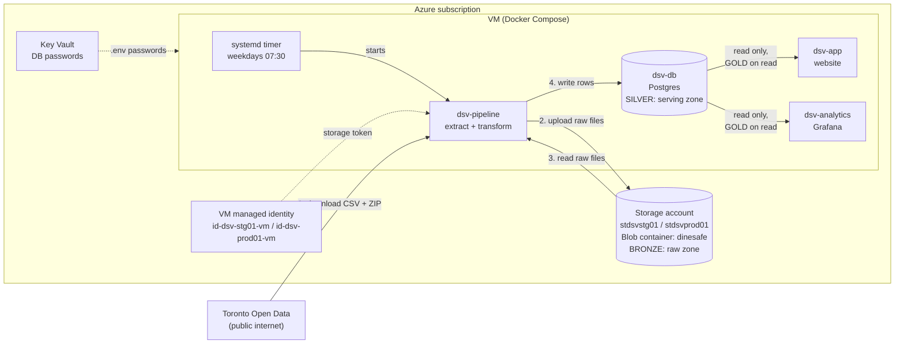
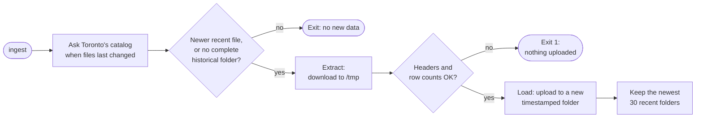

# Data architecture

This page gives a high-level view of how DineSafeViz stores, moves, and serves
DineSafe inspection data. It covers three things, each in its own section:

- **Layers:** where the data lives, and what state it's in.
- **Pipelines:** how data moves between the layers.
- **Operational events:** what happens to each layer when you deploy, redeploy,
  or restart the app.

Each section links to a sub-document with the implementation details.

## Overview

DineSafeViz adapts the
[medallion architecture](https://learn.microsoft.com/azure/databricks/lakehouse/medallion), sorting data into layers, with each layer more refined.

| Medallion layer | Function                                   | DineSafeViz                                       |
| --------------- | ----------------------------------------- | ------------------------------------------------- |
| Bronze          | Raw data, exactly as the source sent it   | Blob container `dinesafe`, the *raw zone*         |
| Silver          | Cleaned, validated, de-duplicated rows    | Postgres `inspections` table, the *serving zone*  |
| Gold            | Aggregated, ready for a specific consumer | Not stored. The app and Grafana aggregate on read |

Modifications:

- **Two stored layers, not three.** Silver and gold share one Postgres
  database. At about 508,000 rows, query-time aggregation is fast enough, so a
  separate gold table isn't needed.
- **ETL, not ELT.** Lakehouses usually transform data inside the platform that
  stores it. DineSafeViz transforms data in the `dsv-pipeline` container, then
  loads finished rows into Postgres. Postgres never transforms data.

## Infrastructure

Both zones live in one Azure subscription per environment. One service,
`dsv-pipeline`, writes data. Everything else only reads.

| Component       | Pulls                   | Transforms              | Stores                         |
| --------------- | ----------------------- | ----------------------- | ------------------------------ |
| `dsv-pipeline`  | Toronto Open Data, Blob | Yes, in memory          | Nothing. One-shot container.   |
| Blob `dinesafe` | —                       | No                      | Raw files, as downloaded       |
| `dsv-db`        | —                       | No                      | `inspections` and `load_log`   |
| `dsv-app`       | `dsv-db`                | Aggregates per request  | A small stats cache, in memory |
| `dsv-analytics` | `dsv-db`                | Aggregates per request  | Nothing                        |

- Same layout in stg and prod. Dev reads stg's storage, read-only.
- Only `dsv-pipeline` can reach the internet. The app and Grafana can't.
- Only the VM's managed identity can write to Blob. There are no storage keys.

For details, see [App architecture](2-app-architecture.md),
[Data operations](3-7-data-operations.md#access-and-credentials), and
[Data readers](3-9-data-readers.md).

## Layers

Each layer has one job. Data only moves forward: bronze feeds silver, and
silver feeds gold.

### Bronze: raw zone

The raw zone holds the source files exactly as Toronto Open Data published
them. It's the source of truth for everything downstream.

- Two source files:
  - **Recent:** `Dinesafe.csv`, November 2023 to today. Updated often.
  - **Historical:** a ZIP of yearly CSVs, 2001 to 2023. Downloaded once.
- Each ingest writes a new timestamped folder. Existing files are never
  overwritten.
- Files are validated before upload, so the raw zone only holds files that
  passed.
- The newest 30 recent folders are kept.
- The raw zone is the backup: it can rebuild the database without Toronto
  Open Data.

For details, see [Data sources](3-2-data-sources.md) and
[Data ingest](3-8-data-ingest.md).

### Silver: serving zone

The serving zone holds cleaned rows in Postgres, ready to query. The pipeline
writes it, and nothing else does.

- Two tables:
  - `inspections`: one row per infraction, about 508,000 rows.
  - `load_log`: one row per successful load, recording which raw files it
    loaded. This is the lineage from silver back to bronze.
- Three database roles, each with least access:
  - Superuser: creates the schema only.
  - `dinesafe_migrator`: the pipeline. Read, insert, and delete.
  - `dinesafe_app`: the app and Grafana. Read only, with a 10-second query
    timeout.

For details, see [Database](3-5-database.md) and
[Data mapping](3-6-data-mapping.md).

### Gold: aggregated on read

Gold data isn't stored. The app and Grafana build it from silver on each
request.

- The app groups inspections by day and establishment, and works out year and
  quarter ranges.
- The home page stats are cached in the app's memory for a short time.
- Grafana dashboards run their own aggregate queries.
- Every query filters on `inspection_date`, which is the table's only index.

For details, see [Data readers](3-9-data-readers.md).

## Pipelines

Three pipelines move data between the layers. `ingest` fills bronze. `seed` and
`refresh` fill silver from bronze. They're separate steps, and only the
scheduled run does both.

| Pipeline  | From → to         | Contacts Toronto? | Runs when                      |
| --------- | ----------------- | ----------------- | ------------------------------ |
| `ingest`  | Toronto → bronze  | Yes               | Scheduled run, or by hand      |
| `seed`    | Bronze → silver   | No                | Load step, table is empty      |
| `refresh` | Bronze → silver   | No                | Load step, newer file in Blob  |

### Ingest: Toronto Open Data to bronze

Ingest copies new files from Toronto Open Data to Blob Storage. It never
touches the database.

- If the raw zone has no complete historical folder, ingest downloads the
  historical ZIP too. You don't need a separate step for it.

For details, see [Data ingest](3-8-data-ingest.md).

### Seed: first fill of silver

A seed fills an empty `inspections` table from the raw zone. It runs as part
of the load step whenever the table is empty.

- The seed is one transaction. If it fails, the table stays empty.

For details, see [Data mapping](3-6-data-mapping.md).

### Refresh: keep silver current

A refresh replaces the recent rows with the newest recent file. The systemd
timer runs it on weekday mornings, right after ingest.

- Only the recent window is replaced. Historical rows are loaded once and
  never touched again.
- The swap is atomic: visitors see the old data until `COMMIT`, then the new
  data. No downtime.
- Any failure rolls back, and the site keeps serving the last good load.
- If Toronto Open Data is down, the data only gets older. Nothing breaks.
- Check the last run with `systemctl status dsv-pipeline.service`.

For details, see [Data operations](3-7-data-operations.md).

## Operational events

Deploys, redeploys, and restarts don't add layers. They're events that run
some of the pipelines, or none. Deploys never contact Toronto Open Data: they
only load from the raw zone.

<!-- prettier-ignore -->
> [!IMPORTANT]
> In a new environment, you must ingest before the first deploy. Run
> `scripts/pipeline.sh <env> ingest`, then `scripts/deploy.sh`.

| Event                          | Bronze (Blob)                | Silver (Postgres)                                                                      |
| ------------------------------ | ---------------------------- | -------------------------------------------------------------------------------------- |
| First deploy, empty raw zone   | Untouched                    | Schema created. The load fails, and the deploy fails with an empty database.           |
| First deploy, raw zone filled  | Read only                    | Schema created, then **seed**.                                                         |
| Redeploy                       | Read only                    | Migrations rerun. Then **refresh** if Blob has a newer file, otherwise skip.           |
| Restart or `docker compose up` | Untouched                    | Untouched. The pipeline isn't started by `up`.                                         |
| Scheduled run                  | New folder if Toronto changed | **Refresh** or skip, then the staleness check.                                        |
| Database volume destroyed      | Untouched                    | Lost. The next deploy is a first deploy, so it seeds from the raw zone.                |

- On every deploy, `deploy.sh` reruns the migrations, then runs the load step.
  Migrations are idempotent.
- If a redeploy's load fails, the deploy prints a warning and the site keeps
  serving the data it already has.
- If the timer fires during a deploy, the load lock makes one load wait for the
  other.

For details, see [Data operations](3-7-data-operations.md).

## Known limits

These limits follow from the design. They matter most while you're changing
the pipeline in stg.

- **Transform changes don't reach historical rows.** A refresh only replaces
  the recent window. If you change the transform, rows before November 2023
  keep the old logic. To reprocess everything, destroy the database volume and
  redeploy, so the next deploy seeds from the raw zone.
- **No down migrations.** Migrations only move forward. Rolling back to an
  older image runs old code against the newer schema.
- **Limited replay window.** The raw zone keeps the newest 30 recent folders,
  so you can't rebuild from a recent file older than that.
- **Environments can differ.** stg and prod each ingest on their own, and dev
  reads stg's raw zone. Before you compare environments, check `load_log` in
  each one.

## Out of scope

Disaster recovery isn't covered yet. The raw zone can rebuild the database,
but losing the storage account itself has no recovery plan.
