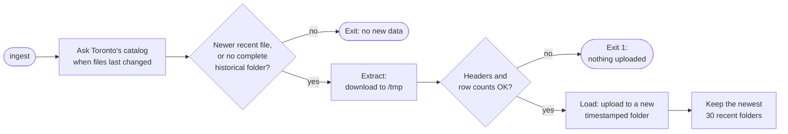
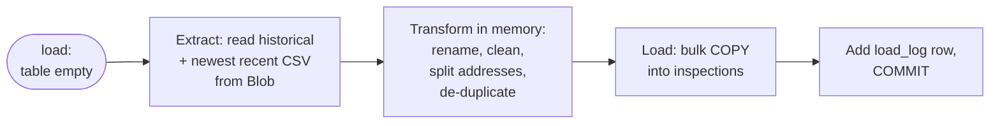
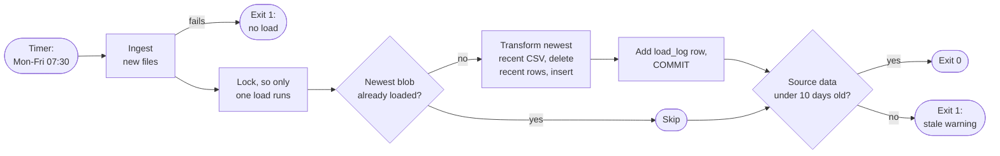

# Data architecture

This page gives a high-level view of how DineSafeViz stores, moves, and serves
DineSafe inspection data.

## Overview

The key data-related tasks of DineSafeViz are to:
1. Perform initial ingest of raw datasets from the Toronto Open Data Portal (TODP)
2. Perform periodic checks to download updated data from the TODP
3. Convert raw data into finished inspection reports and dashboards

The application needs to handle:
1. Fresh application deployment
2. Application redeployment

## Medallion architecture

DineSafeViz adapts the
[medallion architecture](https://learn.microsoft.com/azure/databricks/lakehouse/medallion), sorting data into layers, with each layer more refined.

| Medallion layer | Function                                  | DineSafeViz Component                                                                   |
| --------------- | ----------------------------------------- | ----------------------------------------------------------------------------- |
| Bronze          | Raw data, exactly as the source sent it   | Azure Blob container `dinesafe`, the *raw zone*                                     |
| Silver          | Cleaned, validated, de-duplicated rows    | Postgres container `inspections` table, the *serving zone*                              |
| Gold            | Aggregated, ready for a specific consumer | Not stored. The app and the inspections dashboard (Grafana) aggregate on page read |

Modifications:

- **Two stored layers, not three.** Silver and gold share one Postgres
  database. At about 508,000 rows, query-time aggregation is fast enough, so a
  separate gold table isn't needed.
- **ETL, not ELT.** Lakehouses usually transform data inside the platform that
  stores it. DineSafeViz transforms data in the `dsv-pipeline` container, then
  loads finished rows into Postgres. Postgres never transforms data.

## Pipelines

There are three pipelines: `ingest`, `seed`, and `refresh`. The timer, a
deploy, or an operator starts them.

All three run from `scripts/pipeline.sh <env> <command>`. It gets a storage
token on the host, then starts the one-shot `dsv-pipeline` container, which
runs `pipeline.py <command>`. The command decides which pipelines run:

| Command  | Runs                                         | Started by                                    |
| -------- | -------------------------------------------- | --------------------------------------------- |
| `run`    | `ingest`, then the load step, then freshness | `dsv-pipeline.timer` → `dsv-pipeline.service` |
| `load`   | The load step: `seed`, `refresh`, or skip    | `scripts/deploy.sh`, on every deploy          |
| `ingest` | `ingest` only                                | An operator, by hand                          |

The load step picks `seed` or `refresh` on its own, from the state of the
database:

| Pipeline  | From → to        | Contacts TODP? | Runs when                     | Code                                        |
| --------- | ---------------- | ----------------- | ----------------------------- | ------------------------------------------- |
| `ingest`  | Toronto → bronze | Yes               | `run` or `ingest`             | `data.py: ingest`                           |
| `seed`    | Bronze → silver  | No                | Load step, table is empty     | `pipeline.py: load` → `refresh.py: seed`    |
| `refresh` | Bronze → silver  | No                | Load step, newest file in Blob not loaded yet (or `--force`) | `pipeline.py: load` → `refresh.py: refresh` |

All code paths are under `src/dsv-db/`.

In `run`, each step only starts if the one before it succeeded. If ingest
fails, the load and the freshness check don't run.

### Ingest: Pull data into the bronze layer

The `ingest` pipeline copies new files from Toronto Open Data to Azure Blob Storage. It never
touches the database.

- **Runs:**
  - **automatically**: `dsv-pipeline.timer` (`pipeline.sh <env> run`)
  - **manually** run `scripts/pipeline.sh <env> ingest`. Only stg and prod
    can ingest. dev can only load, from stg's raw zone.

- Deploys never ingest.

- If the raw zone has no complete historical folder, ingest downloads the
  historical ZIP too. You don't need a separate step for it.

- `--force` downloads the recent CSV even if Toronto's `last_modified` isn't
  newer. `--historical` downloads the historical ZIP again.

- If the downloaded recent CSV has the same MD5 as the newest blob, ingest
  doesn't upload it. Pruning only runs after a new recent file is uploaded.

- For details, see [Data ingest](3-8-data-ingest.md).

### Seed: Initial full load of silver layer

The `seed` pipeline fully loads postgres db's `inspections` table from the Azure Blob storage. It runs as part
of the `load` step whenever the table is empty, so a fresh deployment of the app triggers a `seed` operation.

- **Runs:**
  - **automatically:** `scripts/deploy.sh` (`pipeline.sh <env> load`) on the first
  deploy. The timer's `run` also seeds if it finds the table empty.

- The seed is one transaction. If it fails, the table stays empty.

For details, see [Data mapping](3-6-data-mapping.md).

### Refresh: keep silver layer current

The `refresh` pipeline replaces the recent rows with the newest recent file. The systemd
timer runs it on weekday mornings, right after ingest.

- **Run by:**
  - **automatically**: 
    - `dsv-pipeline.timer` (`pipeline.sh <env> run`), Monday to Friday at 07:30 Toronto time, plus a random delay of up to 10 minutes.
      If the VM was off at that time, the timer runs once at the next boot.
    - Every redeploy also runs it through `scripts/deploy.sh` (`pipeline.sh <env> load`)
  - **manually:** run `scripts/pipeline.sh <env> load --force` to reload the
    newest file even if it's already loaded. `run --force` only forces the
    ingest, not the load.

- Only the recent window is replaced: every row on or after the earliest
  `inspection_date` in the newest recent CSV. Rows before that date are never
  touched again.
- The swap is atomic: visitors see the old data until `COMMIT`, then the new
  data. No downtime.
- Any failure rolls back, and the site keeps serving the last good load.
- If Toronto Open Data is down, the timer's run fails at ingest and skips the
  load. The site keeps serving its current data, which only gets older.
- Check the last run with `systemctl status dsv-pipeline.service`.

For details, see [Data operations](3-7-data-operations.md).

## Operational events

What happens to each layer when you deploy, redeploy, or restart the app?

Deploys, redeploys, and restarts don't add layers. They're events that run
some of the pipelines, or none. Deploys never contact Toronto Open Data: they
only load from the raw zone.

<!-- prettier-ignore -->
> [!IMPORTANT]
> When setting up a new stg or prod environment, you must ingest before the first deploy.
> Run `scripts/pipeline.sh <env> ingest`, then `scripts/deploy.sh`. dev
> loads from stg's raw zone, so stg must be ingested first.

| Event                          | Bronze (Blob)                 | Silver (Postgres)                                                            |
| ------------------------------ | ----------------------------- | ---------------------------------------------------------------------------- |
| First deploy, empty raw zone   | Untouched                     | Schema created. The load fails, and the deploy fails with an empty database. |
| First deploy, raw zone filled  | Read only                     | Schema created, then **seed**.                                               |
| Redeploy                       | Read only                     | Migrations rerun. Then **refresh** if Blob has a newer file, otherwise skip. |
| Restart or `docker compose up` | Untouched                     | Untouched. The pipeline isn't started by `up`.                               |
| Scheduled run                  | New folder if Toronto changed | **Refresh** or skip, then the staleness check.                               |
| Database volume destroyed      | Untouched                     | Lost. The next deploy is a first deploy, so it seeds from the raw zone.      |

- Postgres creates the schema (`init.sql` and the migrations) the first time
  `dsv-db` starts on an empty volume. On every deploy, `deploy.sh` reruns the
  migrations, then runs the load step. Migrations are idempotent.
- If a redeploy's load fails, the deploy prints a warning and the site keeps
  serving the data it already has.
- If the timer fires during a deploy, the load lock makes one load wait for the
  other. The second load then finds the file already in `load_log` and skips.

For details, see [Data operations](3-7-data-operations.md).

## Known limits

These limits follow from the design. They matter most while you're changing
the pipeline in stg.

- **Transform changes don't reach historical rows.** A refresh only replaces
  the recent window. If you change the transform, rows before the recent
  CSV's earliest date (currently November 10, 2023) keep the old logic. To
  reprocess everything, destroy the database volume and redeploy, so the next
  deploy seeds from the raw zone.
- **No down migrations.** Migrations only move forward. Rolling back to an
  older image runs old code against the newer schema.
- **Limited replay window.** The raw zone keeps the newest 30 recent folders,
  so you can't rebuild from a recent file older than that.
- **Environments can differ.** stg and prod each ingest on their own, and dev
  reads stg's raw zone. Before you compare environments, check `load_log` in
  each one.

## Out of scope

Disaster recovery isn't covered yet. The raw zone can rebuild the database,
but losing the storage account itself has no recovery plan.
