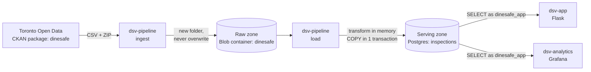
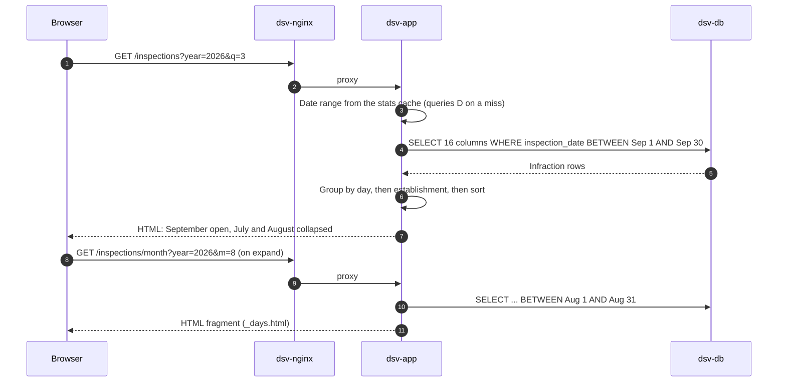
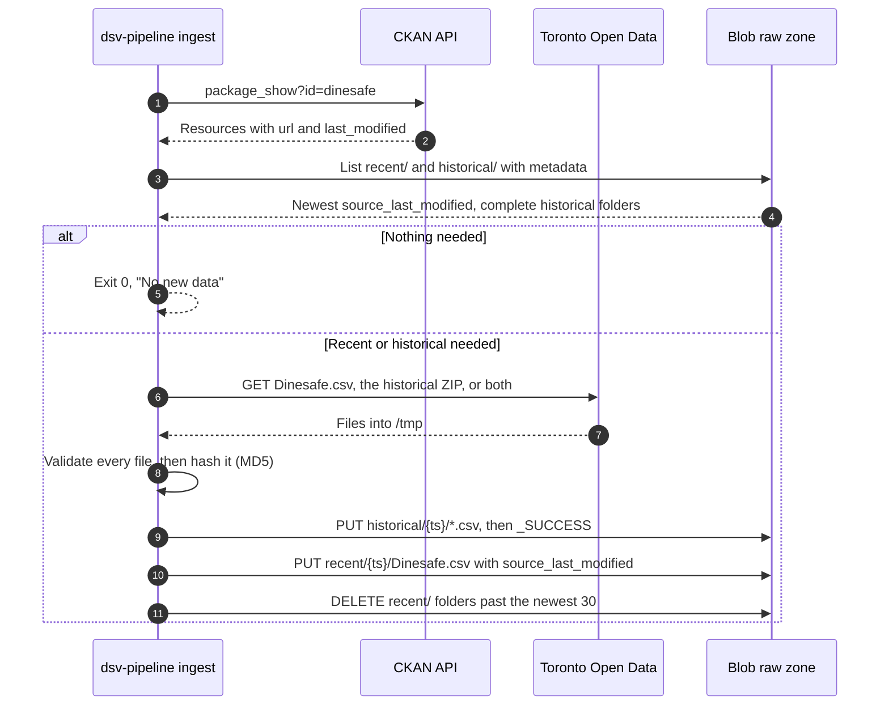
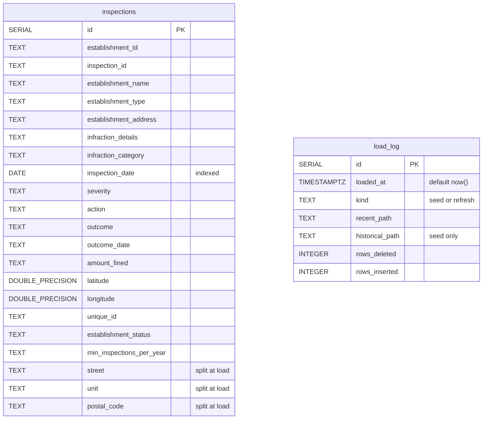
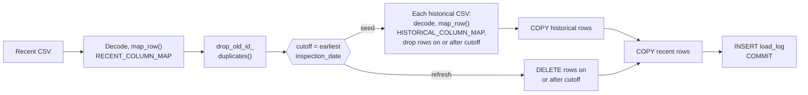
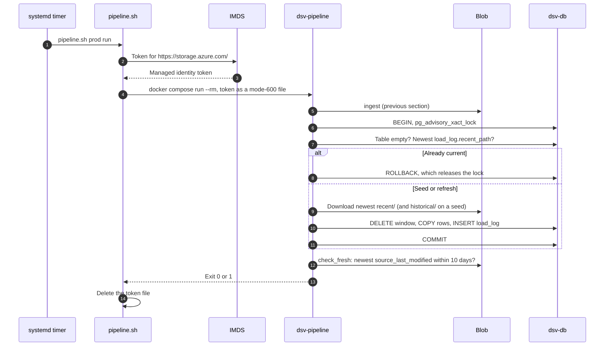

# Data architecture

How DineSafe data gets from Toronto Open Data into Postgres, how it's
transformed, how it stays current, and how the app reads it.

## Overview

Data flows one way through three zones. One one-shot service, `dsv-pipeline`,
writes. Everything else reads.



| Zone      | Where                                       | Holds                               | Writer                        | Readers                           |
| --------- | ------------------------------------------- | ----------------------------------- | ----------------------------- | --------------------------------- |
| Raw       | Blob container `dinesafe` in `stdsv<env>01` | Files as downloaded, never edited   | `ingest`                      | `load`                            |
| Transform | `dsv-pipeline` memory and `/tmp`            | Decoded, mapped, de-duplicated rows | `load`                        | `load`                            |
| Serving   | `dsv-db`, volume `dsv-db-data`              | `inspections`, `load_log`           | `load` as `dinesafe_migrator` | App and Grafana as `dinesafe_app` |

- Only `ingest` and `run` contact Toronto Open Data. Deploys run `load` only.
- The raw zone can rebuild the database at any time, without Toronto.
- `docker compose up`, `restart`, and rebuilds never change data:
  `dsv-pipeline` is in the `pipeline` profile.

### Components

Each component on the data path, and the code that defines it:

| Component                 | Code                                                | Role                                                    |
| ------------------------- | --------------------------------------------------- | ------------------------------------------------------- |
| `dsv-pipeline ingest`     | `src/dsv-db/data.py`                                | Toronto Open Data → raw zone. Never touches Postgres.   |
| `dsv-pipeline load`       | `src/dsv-db/pipeline.py`, `src/dsv-db/refresh.py`   | Raw zone → transform → Postgres. Never contacts Toronto. |
| `scripts/pipeline.sh`     | `scripts/pipeline.sh`, `scripts/lib.sh`             | Gets a storage token, then runs `dsv-pipeline`.          |
| `dsv-pipeline.timer`      | `deploy/systemd/dsv-pipeline.{timer,service}`       | Runs `pipeline.sh <env> run` on weekday mornings (VMs).  |
| `scripts/deploy.sh`       | `scripts/deploy.sh`                                 | Runs migrations, then `pipeline.sh <env> load`.          |
| `dsv-db`                  | `src/dsv-db/init.sql`, `src/dsv-db/migrations/`     | Postgres 18.6. Schema, roles, and grants.                |
| `dsv-app`                 | `src/dsv-app/app.py`                                | Web pages. Reads `inspections`.                          |
| `dsv-analytics`           | `src/dsv-analytics/provisioning/`                   | Grafana dashboard. Reads `inspections`.                  |

## How the app reads data

Two services read Postgres, both as `dinesafe_app`: `SELECT` only, with a
10-second `statement_timeout`. Neither writes.

| Reader          | Code                              | Connection                                                       | Caching                                              |
| --------------- | --------------------------------- | ---------------------------------------------------------------- | ---------------------------------------------------- |
| `dsv-app`       | `src/dsv-app/app.py`              | New psycopg2 connection per query. No pool. 5 s connect timeout. | Inspection count and date range, in memory, 5-day TTL |
| `dsv-analytics` | `src/dsv-analytics/provisioning/` | Provisioned data source `dinesafe-postgres`, `sslmode: disable`  | None. Panels query on every dashboard load.          |

- `load_log` is readable, but nothing displays it yet.
- Connections are plaintext, on the internal `backend` network only.

### Grain: one row per infraction

Both readers depend on how `inspections` stores an inspection.

| `establishment_id`   | `inspection_date` | `establishment_status` | `severity`  | `infraction_details`                              |
| -------------------- | ----------------- | ---------------------- | ----------- | ------------------------------------------------- |
| `001Vo000013QjdPIAS` | 2026-04-21        | Pass                   | M - Minor   | FAIL TO ENSURE EQUIPMENT SURFACE SANITIZED …      |
| `001Vo000013QjdPIAS` | 2026-04-21        | Pass                   | M - Minor   | FOOD PREMISE NOT MAINTAINED TO KEEP …             |
| `10500438`           | 2017-12-05        | Pass                   | `NULL`      | `NULL`                                            |

- Rows 1 and 2: one inspection with two infractions. Row 3: a clean
  inspection, one row with `NULL` infraction fields.
- An inspection is an `(establishment_id, inspection_date)` pair. Recent rows
  have no `inspection_id`.
- The app and Grafana both count `DISTINCT establishment_id, inspection_date`,
  so their totals match: about 333,000 inspections in about 508,000 rows.

### Inspections page

The page queries one month at a time. Older months load when you expand them.



| Function               | Query                                                                  | Feeds                                        |
| ---------------------- | ---------------------------------------------------------------------- | -------------------------------------------- |
| `_get_home_stats()`    | `COUNT(*)`, `MIN` and `MAX(inspection_date)` over distinct inspections | Home and info totals, quarter picker range   |
| `_fetch_inspections()` | 16 columns `WHERE inspection_date BETWEEN start AND end`               | One month of day boxes                       |
| `readyz()`             | `SELECT 1`, 1 s connect timeout                                        | Readiness check                              |

- Page queries filter on `inspection_date`, the only secondary index. The
  stats query scans the whole table, which is why it's cached.
- Python shapes the rows, not SQL:
  - `group_establishments()`: one card per establishment per day, with
    infractions grouped by severity and category.
  - `sort_rows()`: Closed → Conditional Pass → Pass → other, then name and
    address.
  - Infractions: Crucial → Significant → Minor → other.
  - `build_days()`: one box per day in range, including empty days.
- Quarter picker: every year from the first to the last inspection date. The
  end years show only quarters with data. Invalid `year` or `q` falls back to
  the latest quarter.
- Month ranges are clipped to the first inspection date and today.

### Stats cache

`_get_home_stats()` caches the inspection count and the first and last
inspection dates. Every page reads it.

- `inject_globals()`, a context processor, builds the quarter picker from the
  cached range on every `render_template()` call, including fragments.
- One cache per process. Gunicorn runs 1 worker with 4 threads. A lock stops
  threads from filling it at the same time.
- Not cached when the table is empty or the database is down. The range then
  falls back to January 1, 2001 → today, and the next request retries.

<!-- prettier-ignore -->
> [!NOTE]
> New rows show on the inspections pages as soon as a load commits. The home
> totals and the quarter picker range lag by up to 5 days, until the cache
> expires or `dsv-app` restarts. When a new quarter starts, you can't open it
> until then.

### Grafana dashboard

`/dashboard` embeds the Grafana dashboard
`/analytics/d/dinesafe/dinesafe-inspections?kiosk` in an iframe. Visitors see
it as anonymous Viewers.

- Source: `dinesafe.json`, provisioned from files. UI edits are ephemeral:
  export and commit them to `dinesafe.json`.
- 20 SQL panels, so 20 queries per dashboard load, each capped at 10 seconds.
- Default range: last 90 days. No auto-refresh.
- Every panel filters with `$__timeFilter(inspection_date)`.
- Categories use `COALESCE(infraction_category, infraction_details)`, because
  historical rows have no category.
- Establishment-type panels show historical rows only. Those end on November
  9, 2023, so the panels are empty in the default 90-day range.

## How data is ingested

`dsv-pipeline ingest` (`src/dsv-db/data.py`) copies new files from Toronto
Open Data to the raw zone. It never touches Postgres.



| Rule                | Detail                                                                                                                                                                                    |
| ------------------- | ----------------------------------------------------------------------------------------------------------------------------------------------------------------------------------------- |
| Find files          | Exact name and format: `Dinesafe.csv` (CSV) and `Dinesafe Historical Data` (ZIP). Exactly one match each, or fail. Survives resource ID changes and skips the stale `Dinesafe™.csv`.     |
| Download recent     | CKAN `last_modified` is newer than the newest blob's `source_last_modified`, `recent/` is empty, or `--force`.                                                                            |
| Download historical | No `historical/` folder has `_SUCCESS`, or `--historical`.                                                                                                                                |
| Unzip               | Every `.csv` in the ZIP, flattened to its base name. Other files are skipped.                                                                                                             |
| Validate            | Every file, before any upload: mapped headers present, UTF-8 or cp1252, at least 50,000 recent rows and 1,000 rows per historical file. Values aren't checked.                            |
| Skip duplicates     | Doesn't upload a recent file whose MD5 matches the newest blob.                                                                                                                           |
| Upload order        | Historical CSVs, `_SUCCESS`, recent CSV, then prune.                                                                                                                                      |
| Integrity           | `Content-MD5` on every upload, so Blob rejects a corrupted body.                                                                                                                          |
| Timeouts            | 120 seconds without data, per request.                                                                                                                                                    |
| Client              | Plain Blob REST API (`x-ms-version: 2023-11-03`) with a bearer token. No Azure SDK.                                                                                                       |

### Raw zone layout

Each ingest writes to new folders. Nothing is overwritten.

```text
stdsv<env>01 / dinesafe
├── recent/
│   ├── 20261009T113005Z/Dinesafe.csv   metadata: source_last_modified
│   └── 20261012T113012Z/Dinesafe.csv   ← newest: last in sort order
└── historical/
    └── 20261005T140211Z/
        ├── dinesafe_hist_2001.csv … dinesafe_hist_2023.csv
        └── _SUCCESS                     ← written last; no marker, no load
```

- Folder name: the ingest's UTC start time, not Toronto's date. Names sort in
  time order, so there's no manifest.
- A forced download with new content gets its own folder.
- A new `historical/` folder takes effect only on the next seed. Refreshes
  never read `historical/`.

## Database schema

`src/dsv-db/init.sql` and `src/dsv-db/migrations/001_load_log.sql` define two
tables in the `public` schema of the `dinesafe` database. No foreign key
links them.



### `inspections`

One row per infraction, about 508,000 rows. Denormalized: establishment
fields repeat on every row.

| Column                     | Type             | `NULL` when                               | Read by              |
| -------------------------- | ---------------- | ----------------------------------------- | -------------------- |
| `id`                       | SERIAL PK        | Never                                     | —                    |
| `establishment_id`         | TEXT             | Never                                     | App, stats, Grafana  |
| `inspection_id`            | TEXT             | Recent rows                               | —                    |
| `establishment_name`       | TEXT             | Never                                     | App                  |
| `establishment_type`       | TEXT             | Recent rows                               | App, Grafana         |
| `establishment_address`    | TEXT             | Never                                     | App (sort tiebreak)  |
| `infraction_details`       | TEXT             | Clean inspection                          | App, Grafana         |
| `infraction_category`      | TEXT             | Historical rows, clean inspection         | App, Grafana         |
| `inspection_date`          | DATE             | Never                                     | App, stats, Grafana  |
| `severity`                 | TEXT             | Clean inspection                          | App, Grafana         |
| `action`                   | TEXT             | Recent rows, clean inspection             | App                  |
| `outcome`                  | TEXT             | No prosecution (about 99% of rows)        | App                  |
| `outcome_date`             | TEXT             | Historical rows, no outcome               | App                  |
| `amount_fined`             | TEXT             | No fine                                   | App                  |
| `latitude`, `longitude`    | DOUBLE PRECISION | Never                                     | —                    |
| `unique_id`                | TEXT             | Historical rows                           | —                    |
| `establishment_status`     | TEXT             | Never                                     | App, Grafana         |
| `min_inspections_per_year` | TEXT             | Recent rows                               | —                    |
| `street`                   | TEXT             | Never                                     | App                  |
| `unit`                     | TEXT             | No unit found (about 78% of rows)         | App                  |
| `postal_code`              | TEXT             | Historical rows, recent `None`            | App                  |

- "Never" is observed in the data, not enforced: every column except `id` is
  nullable.
- App = `_fetch_inspections()`. Stats = `_get_home_stats()`.
- `unique_id` is `NULL` for every historical row, so `unique_id IS NULL`
  selects the historical era.

### `load_log`

One row per successful seed or refresh. The newest row records what's loaded.

| Column            | Type        | Notes                                                    |
| ----------------- | ----------- | -------------------------------------------------------- |
| `id`              | SERIAL PK   | Newest row = highest `id`                                |
| `loaded_at`       | TIMESTAMPTZ | `NOT NULL`, defaults to `now()`                          |
| `kind`            | TEXT        | `NOT NULL`, `CHECK (kind IN ('seed', 'refresh'))`        |
| `recent_path`     | TEXT        | `NOT NULL`. For example, `recent/20261012T113012Z/Dinesafe.csv` |
| `historical_path` | TEXT        | Seed only. For example, `historical/20261005T140211Z/`   |
| `rows_deleted`    | INTEGER     | `NOT NULL`. Always 0 for a seed.                         |
| `rows_inserted`   | INTEGER     | `NOT NULL`                                               |

- `load()` compares the newest `recent_path` with the newest blob to decide
  whether to skip.

### Indexes and constraints

The schema is minimal: one secondary index and no data constraints on
`inspections`.

- `inspections_inspection_date_idx` on `inspection_date`. Every app, refresh,
  and Grafana query filters on it.
- Primary keys on both `id` columns. No unique, `NOT NULL`, or `CHECK`
  constraints on `inspections`.

### Roles and grants

Three roles. The pipeline and readers never use the superuser.

| Role                                    | `inspections`, `load_log`  | Other                                                                                    |
| --------------------------------------- | -------------------------- | ---------------------------------------------------------------------------------------- |
| Superuser (`DSV_DB_USER`, `dsv_admin`)  | Owner                      | Runs `init.sql` and every migration.                                                      |
| `dinesafe_migrator`                     | `SELECT`, `INSERT`, `DELETE` | `USAGE` on both sequences. No `UPDATE`, `TRUNCATE`, `CREATE`, or `DROP`.                 |
| `dinesafe_app`                          | `SELECT`                   | `statement_timeout = 10s`. Default privileges grant it `SELECT` on future tables.        |

- No `UPDATE` grant, so the pipeline changes data only by delete and insert.

### Schema lifecycle

Postgres creates the schema once. Deploys keep it current.

1. On the first start of an empty `dsv-db-data` volume, the Postgres image
   runs, in name order: `init.sql`, `migrations-001_load_log.sql`, then
   `set-passwords.sh`.
2. On every deploy, `deploy.sh` reruns each `src/dsv-db/migrations/*.sql` as
   the superuser. Migrations are idempotent.
3. `dsv-pipeline load` fills the tables.

- `DSV_DB_NAME` must be `dinesafe`, because `init.sql` grants on that name.
- `set-passwords.sh` runs only on a new volume. Changing a password later
  needs `ALTER ROLE`.

## Data mapping: CSV to database

Two source schemas map into one table. The recent and historical CSVs use
different column names, and each has columns the other lacks. For the source
files themselves, see [Data sources](3-2-data-sources.md).

### Load path

Seed and refresh run the same row transforms from `src/dsv-db/refresh.py`.
They differ in what they delete and which files they read.



- Historical files load one at a time, in file name order, to cap memory.
- `seed()` and `refresh()` never commit. `pipeline.py` adds the `load_log`
  row and commits once.

### Column mapping

Every database column, its source in each CSV, and its transform. A dash (—)
means the source has no such column, so the value is `NULL`.

| DB column                  | Historical CSV              | Recent CSV         | Transform beyond rename and null handling                    |
| -------------------------- | --------------------------- | ------------------ | ------------------------------------------------------------ |
| `id`                       | —                           | —                  | Assigned by `SERIAL` on insert                               |
| `establishment_id`         | `Establishment ID`          | `estId`            | None. Numeric (historical) or `001Vo…` (most recent rows)    |
| `inspection_id`            | `Inspection ID`             | —                  | None                                                         |
| `establishment_name`       | `Establishment Name`        | `estName`          | None                                                         |
| `establishment_type`       | `Establishment Type`        | —                  | None                                                         |
| `establishment_address`    | `Establishment Address`     | `address`          | Kept raw. Also split into the three columns below.          |
| `street`, `unit`, `postal_code` | Derived                | Derived            | `split_address()`                                            |
| `infraction_details`       | `Infraction Details`        | `typeDesc`         | None. The portal swaps `typeDesc` and `deficiencyDesc` descriptions; the code maps by content. |
| `infraction_category`      | —                           | `deficiencyDesc`   | None                                                         |
| `inspection_date`          | `Inspection Date`           | `inspectionDate`   | `MM/DD/YYYY` → `YYYY-MM-DD`, then cast to `DATE`             |
| `severity`                 | `Severity`                  | `severity`         | None                                                         |
| `action`                   | `Action`                    | —                  | None                                                         |
| `outcome`                  | `Outcome`                   | `OutcomeDesc`      | None                                                         |
| `outcome_date`             | —                           | `OutcomeDate`      | None. Stays `TEXT`.                                          |
| `amount_fined`             | `Amount Fined`              | `amountFined`      | None. Stays `TEXT`.                                          |
| `latitude`, `longitude`    | `Latitude`, `Longitude`     | `latitude`, `longitude` | Cast to `DOUBLE PRECISION`                              |
| `unique_id`                | —                           | `unique_id`        | None                                                         |
| `establishment_status`     | `Establishment Status`      | `inspectionStatus` | None                                                         |
| `min_inspections_per_year` | `Min. Inspections Per Year` | —                  | None. Stays `TEXT`, because 37 rows hold the letter `O`.     |

Source columns that aren't stored:

- **Historical:** `Rec #` (also `Rec #"` in the 2020 to 2022 files, which is
  harmless because it isn't mapped).
- **Recent:** `_id`, `phone`, and `observation`. `oldEstId` is read for
  de-duplication, then dropped.

### Transformations

Every row goes through these steps, in order.

| #   | Step      | Code                       | Columns                                        | Before → after                                                     |
| --- | --------- | -------------------------- | ---------------------------------------------- | ------------------------------------------------------------------ |
| 1   | Decode    | `csv_encoding()`           | Whole file                                     | UTF-8 (BOM-tolerant), else cp1252. Only the 2023 historical file is cp1252. |
| 2   | Rename    | `map_row()`                | All mapped                                     | `estId` → `establishment_id`                                       |
| 3   | Fill gaps | `map_row()`                | The other era's columns                        | Missing → `NULL`                                                   |
| 4   | Nulls     | `normalize()`              | All mapped                                     | `"None"` or `""` → `NULL`                                          |
| 5   | Dates     | `normalize_date()`         | `inspection_date`                              | `10/24/2023` → `2023-10-24` (2023 historical file only)            |
| 6   | Address   | `split_address()`          | `establishment_address` → `street`, `unit`, `postal_code` | `3155 Markham Rd Unit-D1 M1X 0B5` → `3155 Markham Rd`, `Unit-D1`, `M1X 0B5` |
| 7   | De-dupe   | `drop_old_id_duplicates()` | Recent `estId`, `oldEstId`, `inspectionDate`   | Drops the numeric-ID copy of an inspection: 3,996 rows             |
| 8   | Overlap   | `exclude_on_or_after()`    | Historical `inspection_date`                   | Drops rows on or after the cutoff (2023-11-10): 4,791 rows         |
| 9   | Escape    | `bulk_insert()`            | All                                            | Tab, CR, LF in values → space. `NULL` → `\N`.                      |
| 10  | Cast      | Postgres `COPY`            | `inspection_date`, `latitude`, `longitude`     | Text → `DATE` or `DOUBLE PRECISION`. One bad value fails the load. |

- Row counts are from the October 14, 2026 data.
- De-dupe rule: drop a row when another row has `oldEstId` equal to its
  `estId`, on the same date, under a different `estId`.
- Overlap rule: the cutoff is computed after de-dupe. Rows with no date are
  kept.

### Address split

`split_address()` handles both address formats. Units need a `Word-` marker
in recent addresses; without one, they stay in `street`.

| Raw `establishment_address`        | `street`              | `unit`    | `postal_code` | Why                                              |
| ---------------------------------- | --------------------- | --------- | ------------- | ------------------------------------------------ |
| `1871 O'Connor Dr None M4A 1X1`    | `1871 O'Connor Dr`    | `NULL`    | `M4A 1X1`     | Recent: `None` unit dropped                      |
| `3155 Markham Rd Unit-D1 M1X 0B5`  | `3155 Markham Rd`     | `Unit-D1` | `M1X 0B5`     | Unit starts at the first `Word-` token           |
| `1 Clairtrell Rd 303 M2N 7H6`      | `1 Clairtrell Rd 303` | `NULL`    | `M2N 7H6`     | No marker, so the unit stays in `street`         |
| `102 Fort York Blvd None None`     | `102 Fort York Blvd`  | `NULL`    | `NULL`        | Recent: no unit, no postal code                  |
| `361 SPADINA AVE None M5T 23`      | `361 SPADINA AVE`     | `NULL`    | `M5T 23`      | Truncated postal code kept as is (16 rows)       |
| `2300 YONGE ST, Unit-C1`           | `2300 YONGE ST`       | `Unit-C1` | `NULL`        | Historical: `street, unit`                       |
| `100 WELLINGTON ST W, BOX 220`     | `100 WELLINGTON ST W` | `BOX 220` | `NULL`        | Historical: anything after `, ` is the unit      |

- A recent address that doesn't end in a postal code or `None` stays whole in
  `street`. The load logs a count of these; it's 0 today.

<details>
<summary>Worked example: one recent row, CSV to database</summary>

The first row of the October 14, 2026 `Dinesafe.csv`, run through `map_row()`:

| CSV column         | Raw value                                                   | DB column                 | Stored value                    |
| ------------------ | ----------------------------------------------------------- | ------------------------- | ------------------------------- |
| `_id`              | `1`                                                         | —                         | Dropped                         |
| `unique_id`        | `0e2432862e567ea16f7020ed88c7776c`                          | `unique_id`               | Same                            |
| `estId`            | `001Vo000013QjdPIAS`                                        | `establishment_id`        | Same                            |
| `oldEstId`         | `10752656`                                                  | —                         | De-dupe only, then dropped      |
| `estName`          | `# HASHTAG INDIA RESTAURANT`                                | `establishment_name`      | Same                            |
| `address`          | `1871 O'Connor Dr None M4A 1X1`                             | `establishment_address`   | Same                            |
|                    |                                                             | `street`                  | `1871 O'Connor Dr`              |
|                    |                                                             | `unit`                    | `NULL`                          |
|                    |                                                             | `postal_code`             | `M4A 1X1`                       |
| `inspectionStatus` | `Pass`                                                      | `establishment_status`    | Same                            |
| `phone`            | `4167522786`                                                | —                         | Dropped                         |
| `inspectionDate`   | `2026-04-21`                                                | `inspection_date`         | `2026-04-21` as `DATE`          |
| `observation`      | `One or more minor infractions were observed …`             | —                         | Dropped                         |
| `typeDesc`         | `FAIL TO ENSURE EQUIPMENT SURFACE SANITIZED AS NECESSARY - SEC. 22` | `infraction_details` | Same                       |
| `deficiencyDesc`   | `05. MAINTENANCE / SANITATION OF NON-FOOD CONTACT SURFACES / EQUIPMENT` | `infraction_category` | Same                  |
| `severity`         | `M - Minor`                                                 | `severity`                | Same                            |
| `OutcomeDate`      | (empty)                                                     | `outcome_date`            | `NULL`                          |
| `OutcomeDesc`      | `None`                                                      | `outcome`                 | `NULL`                          |
| `amountFined`      | (empty)                                                     | `amount_fined`            | `NULL`                          |
| `latitude`         | `43.72198563`                                               | `latitude`                | `43.72198563` as float          |
| `longitude`        | `-79.30349182`                                              | `longitude`               | `-79.30349182` as float         |
| —                  |                                                             | `inspection_id`, `establishment_type`, `action`, `min_inspections_per_year` | `NULL` (historical only) |
| —                  |                                                             | `id`                      | Next `SERIAL` value             |

</details>

### Not normalized

The load maps columns but keeps values as published. Queries that span both
eras must handle these differences.

| Difference          | Historical                          | Recent                                        |
| ------------------- | ----------------------------------- | --------------------------------------------- |
| Establishment ID    | Numeric                             | Mostly `001Vo…`; `oldEstId` isn't stored, so eras can't be linked |
| Severity "NA"       | `NA - Not Applicable`               | `NA`                                          |
| Status values       | `Pass`, `Conditional Pass`          | Adds `Closed`, `Temporarily Not Operating`    |
| Category            | None                                | Two schemes: `5C. …` to November 7, 2025, `05. …` from November 5, 2025 |
| Outcome spelling    | —                                   | `Conviction - Fined` and `Conviction: Fined`  |
| Casing              | Upper case names and addresses      | Mixed case                                    |
| Trailing spaces     | Not trimmed: 44,616 `infraction_details` values | Not trimmed: 24,111 `infraction_details` values |

## How data is refreshed

A refresh is `pipeline.sh <env> run`: ingest, load, then a staleness check.
Deploys run the load step only.

### Triggers

Every trigger runs the same code through `scripts/pipeline.sh`.

| Trigger                          | Command                                             | Toronto Open Data | Load                                    |
| -------------------------------- | --------------------------------------------------- | ----------------- | --------------------------------------- |
| `dsv-pipeline.timer` (stg, prod) | `pipeline.sh <env> run`                             | If newer          | If there's a new blob                   |
| `deploy.sh stg`, `prod`, `dev`   | `pipeline.sh <env> load`                            | Never             | Seed, refresh, or skip                  |
| Operator                         | `pipeline.sh <env> run --force`                     | Always downloads  | If the content changed                  |
| Operator                         | `pipeline.sh <env> ingest [--force] [--historical]` | Yes               | No                                      |
| Operator                         | `pipeline.sh <env> load [--force]`                  | Never             | Yes. `--force` reloads the newest blob. |

- Timer: `Mon..Fri 07:30 America/Toronto`, plus up to 10 minutes of random
  delay. `Persistent=true` runs a missed start at the next boot. systemd stops
  a run after 30 minutes.
- `run --force` forces the download, not the load.
- Dev can only `load`, from stg's raw zone.

### End to end

A scheduled run on the VM, from timer to exit code:



- If ingest fails, `run` stops: no load and no staleness check.

### Load decision

`pipeline.load()` picks seed, refresh, or skip from `inspections` and
`load_log`.


- A seed fails if `historical/` has no complete folder. Run
  `pipeline.sh <env> ingest --historical` first.
- The skip check compares blob paths, not content.

### The recent window

A refresh replaces everything from the cutoff onward with the newest recent
CSV.

```text
inspection_date ──────────────────────────────────────────────────────────▶
2001-01-01                         cutoff                              today
│◀──────────── historical ───────────▶│◀───────── recent window ─────────▶│
  Loaded on seed. Never touched again. │  Every refresh:
  Rows on or after the cutoff are      │  DELETE WHERE inspection_date >= cutoff
  dropped as overlap.                  │  then COPY the whole recent CSV
                                       │
                         cutoff = earliest inspectionDate in the recent CSV
                                  (2023-11-10 with the current feed)
```

- Picks up Toronto's corrections, deletions, and backfill anywhere in the
  window, not just new rows.
- The cutoff follows each file. If Toronto trims the window, rows before the
  new cutoff stay as last loaded.

### Guarantees

The load's design gives readers these properties:

- **Atomic:** the delete, the insert, and the `load_log` row commit together.
  Readers see the old rows until `COMMIT`, then the new ones, and aren't
  blocked.
- **Idempotent:** loading the same blob again skips.
- **Serialized:** the advisory lock (`0x44535640AD`) makes a deploy's load and
  the timer's load take turns. The second sees the first's `load_log` row and
  skips.
- **Isolated from Toronto:** deploys and dev never ingest, so an Open Data
  outage only makes data older.

### Size

Measured with the October 14, 2026 data, unless noted:

| Measure                | Value                                                        |
| ---------------------- | ------------------------------------------------------------ |
| Seed                   | 508,445 rows: 390,835 historical, 117,610 recent             |
| Refresh                | Deletes and inserts about 117,600 rows                       |
| Recent CSV             | About 45 MB                                                  |
| Seed download          | About 125 MB, held in `/tmp`                                 |
| Seed memory peak       | About 430 MiB, under the 768 MiB container limit             |
| `inspections` on disk  | About 136 MB: 120 MB table, 15 MB indexes (October 5, 2026)  |
| `recent/`              | About 1.4 GB at 30 folders                                   |

- Each refresh leaves about 117,600 dead rows. Autovacuum, on by default,
  reclaims them.
- Each refresh uses about 117,600 new `id` values. At one refresh per weekday,
  `SERIAL` lasts about 70 years.

## Operations

Access, failures, recovery, and environments for the data path.

### Access and credentials

Each hop on the data path uses its own identity, with the least access it
needs.

| Hop                         | Identity                                         | Credential                              | Permission                                            |
| --------------------------- | ------------------------------------------------ | --------------------------------------- | ----------------------------------------------------- |
| Pipeline → Blob (stg, prod) | VM managed identity `id-dsv-<env>01-vm`          | IMDS token for `storage.azure.com` only | Storage Blob Data Contributor on container `dinesafe` |
| Pipeline → Blob (dev)       | `dsv-ops01`, through `sg-dsv-stg01-operators`    | `az account get-access-token`           | Storage Blob Data Reader on stg's container           |
| Pipeline → Postgres         | `dinesafe_migrator`                              | Key Vault secret → `.env`               | `SELECT`, `INSERT`, `DELETE` on both tables           |
| App, Grafana → Postgres     | `dinesafe_app`                                   | Key Vault secret → `.env`               | `SELECT` on both tables, 10 s timeout                 |

- **Token:** minted on the host for each run, mounted at
  `/run/secrets/storage-token` (mode 600), and deleted on exit. Never an
  argument or environment variable.
- **No tokens from containers:** `dsv-imds-block.service` drops container
  traffic to IMDS.
- **Storage account:** Entra ID only (shared keys off), no public blobs, TLS
  1.2, default-deny firewall with `--bypass None`. Allows the VM subnet and
  the operator's home IP.
- **Network:** `dsv-pipeline` is the only service on both `egress` and
  `backend`. The app and Grafana can't reach the internet.

### Failure handling

Every pipeline failure leaves the site serving its last good load, unless the
database is empty.

| Failure                                                   | Result                                                   | Site serves    |
| --------------------------------------------------------- | -------------------------------------------------------- | -------------- |
| Toronto Open Data down, CKAN changed, or validation fails | Nothing uploaded. `run` exits 1.                         | Last good load |
| Blob unreachable: firewall, token, or role                | `load` or `run` exits 1                                  | Last good load |
| Load fails partway, including out of memory               | Rollback. No `load_log` row.                             | Last good load |
| Bad value in a typed column (date, coordinate)            | `COPY` fails, rollback. Repeats until Toronto fixes it.  | Last good load |
| Newest source data over 10 days old                       | `run` loads what it has, then exits 1                    | Newest load    |
| Deploy's load fails, table has rows                       | Deploy warns and continues                               | Last good load |
| Deploy's load fails, table is empty                       | Deploy fails                                             | Nothing        |
| Run takes over 30 minutes                                 | systemd stops it                                         | Last good load |
| Postgres down                                             | `/inspections` returns 500. `/` works only while stats are cached. `/info` renders, with totals only if cached. `/readyz` returns 503. | Partial |

### Retention and recovery

The raw zone is the only backup of the data. Postgres has no backup of its
own.

| Data                   | Kept                        | How                                                          |
| ---------------------- | --------------------------- | ------------------------------------------------------------ |
| `recent/` folders      | Newest 30                   | `prune_recent()` after each recent upload. Never the newest. |
| `historical/` folders  | All                         | Never pruned                                                 |
| Deleted blobs          | 7 days                      | Soft delete                                                  |
| Previous blob versions | 30 days                     | Versioning, plus lifecycle rule `delete-old-versions`        |
| Postgres               | Until the volume is removed | Rebuilt from the raw zone. Prod: manual OS disk snapshot before each deploy. |

| Situation                        | Fix                                                                  |
| -------------------------------- | -------------------------------------------------------------------- |
| Database lost, or a new VM       | Deploy, or run `pipeline.sh <env> load`. Seeds from the raw zone.    |
| Raw zone empty                   | Run `pipeline.sh <env> ingest`, then deploy again.                   |
| Transform bug in recent rows     | Fix and deploy, then run `pipeline.sh <env> load --force`.           |
| Transform bug in historical rows | Empty `inspections`, then `load` to reseed. No script does this yet. |

### Environments

The pipeline runs the same code everywhere, with different storage and
identity.

|                   | dev                         | stg                             | prod                       |
| ----------------- | --------------------------- | ------------------------------- | -------------------------- |
| Raw zone          | `stdsvstg01`, read-only     | `stdsvstg01`                    | `stdsvprod01`              |
| Commands          | `load`                      | `ingest`, `load`, `run`         | `ingest`, `load`, `run`    |
| Timer             | No                          | Yes                             | Yes                        |
| Storage token     | Your `az login`             | VM managed identity             | VM managed identity        |
| Pipeline image    | Built from the working tree | GHCR `dsv-init-db:sha-<commit>` | GHCR `dsv-init-db:<X.Y.Z>` |
| Network isolation | None (default network)      | `egress` and `backend`          | `egress` and `backend`     |

- stg and prod each ingest on their own, so they can briefly serve different
  data.
- Dev also needs your home IP in stg's storage firewall.

### Check the pipeline

To check the pipeline on a VM, run these from the repo directory:

```bash
systemctl list-timers dsv-pipeline.timer               # next and last run
systemctl status dsv-pipeline.service                  # last result
journalctl -u dsv-pipeline.service -n 50 --no-pager    # last run's output
docker compose exec -T dsv-db sh -c 'psql -U "$POSTGRES_USER" -d "$POSTGRES_DB"' <<'SQL'
SELECT loaded_at, kind, recent_path, rows_deleted, rows_inserted
FROM load_log ORDER BY id DESC LIMIT 5;
SQL
```

### Known gaps

These limits exist in the current code:

- **No alerting:** a failed run shows only as a `failed` unit and in the
  journal.
- **Shallow validation:** headers and row counts only. A valid-looking but
  wrong file replaces the window until a good one arrives.
- **`NULL` dates:** a recent row with no `inspectionDate` would be inserted on
  every refresh and never deleted, because `DELETE ... >= cutoff` skips
  `NULL`. No such rows exist today.
- **No stable row key:** refresh reinserts recent rows with new `id` values.
  `unique_id` is recent only and isn't unique-constrained.
- **Unused columns:** `latitude`, `longitude`, `unique_id`, `inspection_id`,
  and `min_inspections_per_year` are stored but nothing reads them.
- **Dashboard note is wrong:** the Grafana text panel says establishment type
  runs to 2023-12-31. The data ends on 2023-11-09.
- **No reseed script:** fixing historical rows needs a manual empty and
  reload.

## Related docs

These pages cover the parts of the data path this page summarizes:

- [App architecture](2-app-architecture.md): services, networks, and roles.
- [Data sources](3-2-data-sources.md): source files, columns, and quirks.
- [Data landing zone](../../docs/explanation/data-landing-zone.md): why the
  pipeline works this way.
- [Identity and access management](../../docs/ref/iam.md): Azure roles and the
  storage firewall.
