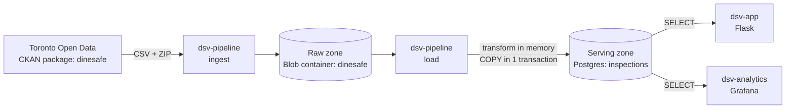
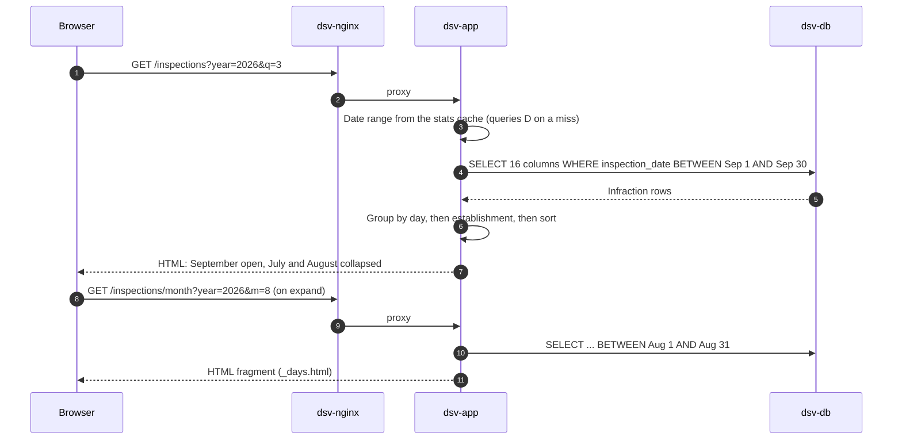
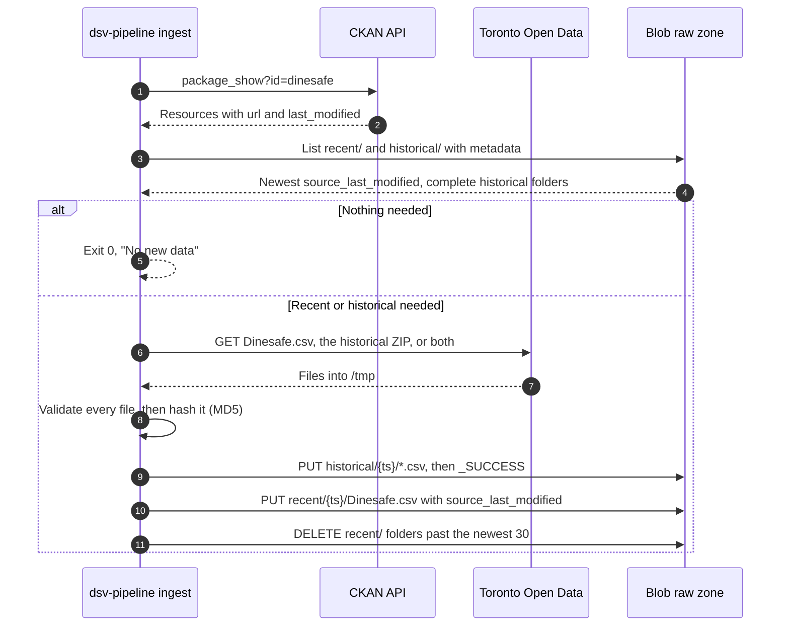
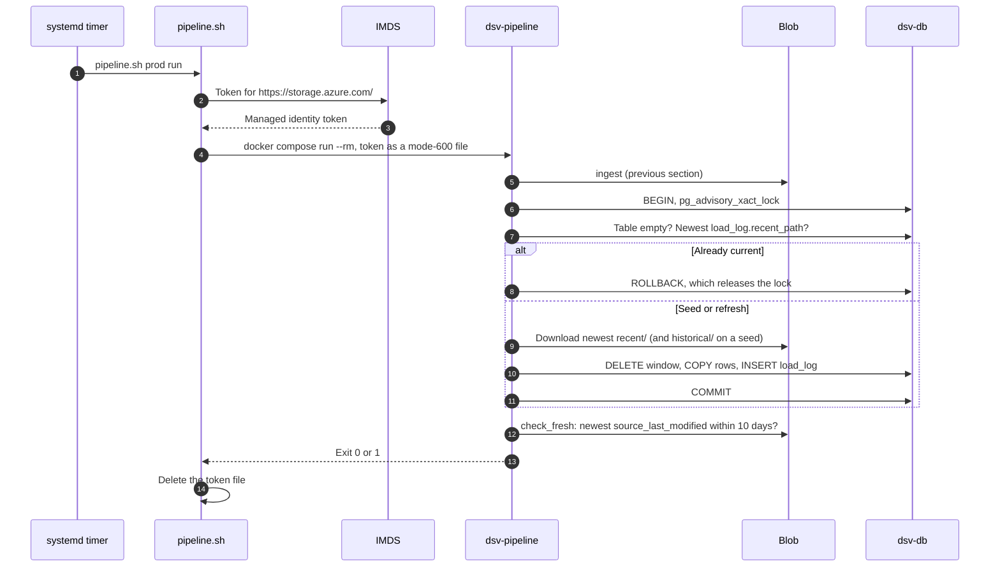
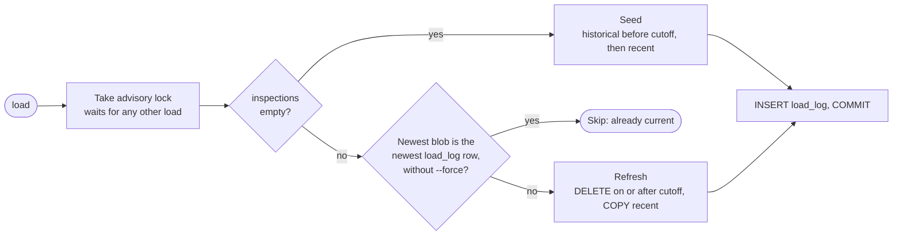

# Data architecture

How DineSafe data gets from Toronto Open Data into Postgres, stays current,
and reaches the app.

## Overview

Data flows one way through three zones. One one-shot service, `dsv-pipeline`,
writes. Everything else reads.



| Zone      | Where                                     | Holds                               | Writer                        | Readers                               |
| --------- | ----------------------------------------- | ----------------------------------- | ----------------------------- | ------------------------------------- |
| Raw       | Blob container `dinesafe` in `stdsv<env>01` | Files as downloaded, never edited | `ingest`                      | `load`                                |
| Transform | `dsv-pipeline` memory and `/tmp` tmpfs    | Decoded, mapped, de-duplicated rows | `load`                        | `load`                                |
| Serving   | `dsv-db`, volume `dsv-db-data`            | `inspections`, `load_log`           | `load` as `dinesafe_migrator` | App and Grafana as `dinesafe_app`     |

- Only `ingest` and `run` contact Toronto Open Data. Deploys run `load` only.
- The raw zone can rebuild the database at any time, without Toronto.
- `docker compose up`, `restart`, and rebuilds never change data:
  `dsv-pipeline` is in the `pipeline` profile.

## How the app reads data

Two services read Postgres, both as `dinesafe_app`: `SELECT` only, with a
10-second `statement_timeout`. Neither writes.

| Reader          | Code                                     | Connection                                                   | Caching                                     |
| --------------- | ---------------------------------------- | ------------------------------------------------------------ | ------------------------------------------- |
| `dsv-app`       | `src/dsv-app/app.py`                     | New psycopg2 connection per query. No pool. 5 s connect timeout. | Home stats only, in memory, 5-day TTL   |
| `dsv-analytics` | `src/dsv-analytics/provisioning/`        | Provisioned data source `dinesafe-postgres`                  | None. Panels query on every dashboard load. |

- `load_log` is readable, but nothing displays it yet.
- Connections are plaintext, on the internal `backend` network only.

### Grain: one row per infraction

Both readers depend on how `inspections` stores an inspection.

- One row per infraction. A clean inspection is one row with `NULL`
  infraction fields.
- An inspection is an `(establishment_id, inspection_date)` pair. Recent rows
  have no `inspection_id`.
- The app and Grafana both count `DISTINCT establishment_id, inspection_date`,
  so their totals match.

### Inspections page

The page queries one month at a time. Older months load when you expand them.



| Function               | Query                                                                     | Feeds                                       |
| ---------------------- | ------------------------------------------------------------------------- | ------------------------------------------- |
| `_get_home_stats()`    | `COUNT(*)`, `MIN` and `MAX(inspection_date)` over distinct inspections    | Home and info totals, quarter picker range  |
| `_fetch_inspections()` | 16 columns `WHERE inspection_date BETWEEN start AND end`                  | One month of day boxes                      |
| `readyz()`             | `SELECT 1`, 1 s connect timeout                                           | Readiness check                             |

- Page queries filter on `inspection_date`, the only index. The stats query
  scans the whole table, which is why it's cached.
- Python shapes the rows, not SQL:
  - `group_establishments()`: one card per establishment per day, with
    infractions grouped by severity and category.
  - `sort_rows()`: Closed → Conditional Pass → Pass → other, then name and
    address.
  - Infractions: Crucial → Significant → Minor → other.
  - `build_days()`: one box per day in range, including empty days.
- Quarter picker: every year from the first to the last inspection date. The
  end years show only quarters with data. Invalid `year` or `q` falls back to
  the latest quarter.
- Month ranges are clipped to the first inspection date and today.

### Stats cache

`_get_home_stats()` caches the inspection count and the first and last
inspection dates.

- One cache per process. Gunicorn runs 1 worker with 4 threads. A lock stops
  threads from filling it at the same time.
- Not cached when the table is empty or the database is down. The range then
  falls back to January 1, 2001 → today.

<!-- prettier-ignore -->
> [!NOTE]
> New rows show on the inspections pages as soon as a load commits. The home
> totals and the quarter picker range lag by up to 5 days, until the cache
> expires or `dsv-app` restarts. When a new quarter starts, you can't open it
> until then.

### Grafana dashboard

`/dashboard` embeds the Grafana dashboard
`/analytics/d/dinesafe/dinesafe-inspections?kiosk` in an iframe. Visitors see
it as anonymous Viewers.

- Source: `dinesafe.json`, provisioned from files. UI edits are ephemeral:
  export and commit them to `dinesafe.json`.
- Default range: last 90 days. No auto-refresh.
- Every panel filters with `$__timeFilter(inspection_date)`.
- Categories use `COALESCE(infraction_category, infraction_details)`, because
  historical rows have no category.
- Establishment-type panels show historical rows only. Those end the day
  before the cutoff: November 9, 2023, with the current feed.

## How data is ingested

`dsv-pipeline ingest` (`src/dsv-db/data.py`) copies new files from Toronto
Open Data to the raw zone. It never touches Postgres.



| Rule                | Detail                                                                                                                                         |
| ------------------- | ---------------------------------------------------------------------------------------------------------------------------------------------- |
| Find files          | Exact name and format: `Dinesafe.csv` (CSV) and `Dinesafe Historical Data` (ZIP). Exactly one match each, or fail. Survives resource ID changes and skips the stale `Dinesafe™.csv`. |
| Download recent     | CKAN `last_modified` is newer than the newest blob's `source_last_modified`, `recent/` is empty, or `--force`.                                 |
| Download historical | No `historical/` folder has `_SUCCESS`, or `--historical`.                                                                                     |
| Validate            | Every file, before any upload: required headers, UTF-8 or cp1252, at least 50,000 recent rows and 1,000 rows per historical file.             |
| Skip duplicates     | Doesn't upload a recent file whose MD5 matches the newest blob.                                                                                |
| Upload order        | Historical CSVs, `_SUCCESS`, recent CSV, then prune.                                                                                           |
| Integrity           | `Content-MD5` on every upload, so Blob rejects a corrupted body.                                                                               |
| Timeouts            | 120 seconds without data, per request.                                                                                                         |
| Client              | Plain Blob REST API (`x-ms-version: 2023-11-03`) with a bearer token. No Azure SDK.                                                            |

### Raw zone layout

Each ingest writes to new folders. Nothing is overwritten.

```text
stdsv<env>01 / dinesafe
├── recent/
│   ├── 20261009T113005Z/Dinesafe.csv   metadata: source_last_modified
│   └── 20261012T113012Z/Dinesafe.csv   ← newest: last in sort order
└── historical/
    └── 20261005T140211Z/
        ├── dinesafe_hist_2001.csv … dinesafe_hist_2023.csv
        └── _SUCCESS                     ← written last; no marker, no load
```

- Folder name: the ingest's UTC start time, not Toronto's date. Names sort in
  time order, so there's no manifest.
- A forced download with new content gets its own folder.

## How data is refreshed

A refresh is `pipeline.sh <env> run`: ingest, load, then a staleness check.
Deploys run the load step only.

### Triggers

Every trigger runs the same code through `scripts/pipeline.sh`.

| Trigger                          | Command                                             | Toronto Open Data  | Load                                   |
| -------------------------------- | --------------------------------------------------- | ------------------ | -------------------------------------- |
| `dsv-pipeline.timer` (stg, prod) | `pipeline.sh <env> run`                             | If newer           | If there's a new blob                  |
| `deploy.sh stg`, `prod`, `dev`   | `pipeline.sh <env> load`                            | Never              | Seed, refresh, or skip                 |
| Operator                         | `pipeline.sh <env> run --force`                     | Always downloads   | If the content changed                 |
| Operator                         | `pipeline.sh <env> ingest [--force] [--historical]` | Yes                | No                                     |
| Operator                         | `pipeline.sh <env> load [--force]`                  | Never              | Yes. `--force` reloads the newest blob. |

- Timer: `Mon..Fri 07:30 America/Toronto`, plus up to 10 minutes of random
  delay. `Persistent=true` runs a missed start at the next boot. systemd stops
  a run after 30 minutes.
- Dev can only `load`, from stg's raw zone.

### End to end

A scheduled run on the VM, from timer to exit code:



### Load decision

`pipeline.load()` picks seed, refresh, or skip from `inspections` and
`load_log`.



- A seed fails if `historical/` has no complete folder. Run
  `pipeline.sh <env> ingest --historical` first.

### The recent window

A refresh replaces everything from the cutoff onward with the newest recent
CSV.

```text
inspection_date ──────────────────────────────────────────────────────────▶
2001-01-01                         cutoff                              today
│◀──────────── historical ───────────▶│◀───────── recent window ─────────▶│
  Loaded on seed. Never touched again. │  Every refresh:
  Rows on or after the cutoff are      │  DELETE WHERE inspection_date >= cutoff
  dropped as overlap.                  │  then COPY the whole recent CSV
                                       │
                         cutoff = earliest inspectionDate in the recent CSV
                                  (2023-11-10 with the current feed)
```

- Picks up Toronto's corrections, deletions, and backfill anywhere in the
  window, not just new rows.
- The cutoff follows each file. If Toronto trims the window, rows before the
  new cutoff stay as last loaded.

### Transform

Seed and refresh run the same steps from `src/dsv-db/refresh.py`.

| Step    | Function                   | Does                                                                   |
| ------- | -------------------------- | ---------------------------------------------------------------------- |
| Decode  | `csv_encoding()`           | UTF-8 (BOM-tolerant), else cp1252. Per file.                           |
| Map     | `map_row()`                | Renames columns with `RECENT_COLUMN_MAP` or `HISTORICAL_COLUMN_MAP`. Missing columns → `NULL`. |
| Nulls   | `normalize()`              | `""` and `"None"` → `NULL`.                                            |
| Dates   | `normalize_date()`         | `MM/DD/YYYY` (2023 historical file) → `YYYY-MM-DD`.                    |
| Address | `split_address()`          | → `street`, `unit`, `postal_code`. Logs unparsed recent addresses.     |
| De-dupe | `drop_old_id_duplicates()` | Recent only. Drops the old-numeric-ID copy of an inspection.           |
| Cutoff  | `min_inspection_date()`    | Earliest recent `inspection_date`.                                     |
| Insert  | `bulk_insert()`            | `COPY` from a tab-separated buffer. Tabs and newlines in values → spaces. |

For each column, see [Data mapping](../../docs/ref/data-mapping.md).

### Guarantees

The load's design gives readers these properties:

- **Atomic:** the delete, the insert, and the `load_log` row commit together.
  Readers see the old rows until `COMMIT`, then the new ones, and aren't
  blocked.
- **Idempotent:** loading the same blob again skips.
- **Serialized:** the advisory lock (`0x44535640AD`) makes a deploy's load and
  the timer's load take turns. The second sees the first's `load_log` row and
  skips.
- **Isolated from Toronto:** deploys and dev never ingest, so an Open Data
  outage only makes data older.

### Size

Measured with the October 14, 2026 data:

| Measure          | Value                                             |
| ---------------- | ------------------------------------------------- |
| Seed             | 508,445 rows: 390,835 historical, 117,610 recent  |
| Refresh          | Deletes and inserts about 117,600 rows            |
| Recent CSV       | About 45 MB                                       |
| Seed download    | About 125 MB, held in the `/tmp` tmpfs            |
| Seed memory peak | About 430 MiB, under the 768 MiB container limit  |
| `recent/`        | About 1.4 GB at 30 folders                        |

## Data model

`src/dsv-db/init.sql` and `src/dsv-db/migrations/001_load_log.sql` define two
tables.

| Table         | Rows                               | Key facts                                                                                       |
| ------------- | ---------------------------------- | ----------------------------------------------------------------------------------------------- |
| `inspections` | One per infraction, about 508,000  | 22 columns, denormalized. Only index: `inspection_date`. `street`, `unit`, and `postal_code` are split at load. |
| `load_log`    | One per successful seed or refresh | Newest row = what's loaded: `recent_path`, `historical_path` (seed only), and row counts.       |

- First start of an empty `dsv-db-data` volume: Postgres runs `init.sql`,
  `001_load_log.sql`, then `set-passwords.sh`.
- `deploy.sh` reruns every migration as the superuser on each deploy. They're
  idempotent.
- `DSV_DB_NAME` must be `dinesafe`, because `init.sql` grants on that name.
- Some columns exist in one era only. See
  [Known inconsistencies](../../docs/ref/data-mapping.md#known-inconsistencies).

## Access and credentials

Each hop on the data path uses its own identity, with the least access it
needs.

| Hop                            | Identity                               | Credential                               | Permission                                            |
| ------------------------------ | -------------------------------------- | ---------------------------------------- | ----------------------------------------------------- |
| Pipeline → Blob (stg, prod)    | VM managed identity `id-dsv-<env>01-vm` | IMDS token for `storage.azure.com` only | Storage Blob Data Contributor on container `dinesafe` |
| Pipeline → Blob (dev)          | `dsv-ops01`, through `az login`        | `az account get-access-token`            | Storage Blob Data Reader on stg's container           |
| Pipeline → Postgres            | `dinesafe_migrator`                    | Key Vault secret → `.env`                | `SELECT`, `INSERT`, `DELETE` on both tables           |
| App, Grafana → Postgres        | `dinesafe_app`                         | Key Vault secret → `.env`                | `SELECT` on both tables, 10 s timeout                 |

- **Token:** minted on the host for each run, mounted at
  `/run/secrets/storage-token` (mode 600), and deleted on exit. Never an
  argument or environment variable.
- **No tokens from containers:** `dsv-imds-block.service` drops container
  traffic to IMDS.
- **Storage account:** Entra ID only (shared keys off), no public blobs, TLS
  1.2, default-deny firewall with `--bypass None`. Allows the VM subnet and
  the operator's home IP.
- **Network:** `dsv-pipeline` is the only service on both `egress` and
  `backend`. The app and Grafana can't reach the internet.
- **Query cap:** `dinesafe_app`'s limits apply to every query, including
  anonymous Grafana API queries.

## Failure handling

Every failure leaves the site serving its last good load, unless the database
is empty.

| Failure                                              | Result                                      | Site serves    |
| ---------------------------------------------------- | ------------------------------------------- | -------------- |
| Toronto Open Data down, CKAN changed, or validation fails | Nothing uploaded. `run` exits 1.       | Last good load |
| Blob unreachable: firewall, token, or role           | `load` or `run` exits 1                     | Last good load |
| Load fails partway, including out of memory          | Rollback. No `load_log` row.                | Last good load |
| Newest source data over 10 days old                  | `run` loads what it has, then exits 1       | Newest load    |
| Deploy's load fails, table has rows                  | Deploy warns and continues                  | Last good load |
| Deploy's load fails, table is empty                  | Deploy fails                                | Nothing        |
| Run takes over 30 minutes                            | systemd stops it                            | Last good load |

- No alerting yet. A failed run shows only as a `failed` unit and in the
  journal.
- Validation checks headers and row counts, not content. A valid-looking but
  wrong file replaces the window until a good one arrives.

To check the pipeline on a VM, run these from the repo directory:

```bash
systemctl list-timers dsv-pipeline.timer               # next and last run
systemctl status dsv-pipeline.service                  # last result
journalctl -u dsv-pipeline.service -n 50 --no-pager    # last run's output
docker compose exec -T dsv-db sh -c 'psql -U "$POSTGRES_USER" -d "$POSTGRES_DB"' <<'SQL'
SELECT loaded_at, kind, recent_path, rows_deleted, rows_inserted
FROM load_log ORDER BY id DESC LIMIT 5;
SQL
```

## Retention and recovery

The raw zone is the only backup of the data. Postgres has no backup of its
own.

| Data                   | Kept                        | How                                                         |
| ---------------------- | --------------------------- | ----------------------------------------------------------- |
| `recent/` folders      | Newest 30                   | `prune_recent()` after each recent upload. Never the newest. |
| `historical/` folders  | All                         | Never pruned                                                |
| Deleted blobs          | 7 days                      | Soft delete                                                 |
| Previous blob versions | 30 days                     | Versioning, plus lifecycle rule `delete-old-versions`       |
| Postgres               | Until the volume is removed | Rebuilt from the raw zone. Prod also snapshots its OS disk before each deploy. |

| Situation                       | Fix                                                                  |
| ------------------------------- | -------------------------------------------------------------------- |
| Database lost, or a new VM      | Deploy, or run `pipeline.sh <env> load`. Seeds from the raw zone.    |
| Raw zone empty                  | Run `pipeline.sh <env> ingest`, then deploy again.                   |
| Transform bug in recent rows    | Fix and deploy, then run `pipeline.sh <env> load --force`.           |
| Transform bug in historical rows | Empty `inspections`, then `load` to reseed. No script does this yet. |

## Environments

The pipeline runs the same code everywhere, with different storage and
identity.

|                   | dev                          | stg                              | prod                             |
| ----------------- | ---------------------------- | -------------------------------- | -------------------------------- |
| Raw zone          | `stdsvstg01`, read-only      | `stdsvstg01`                     | `stdsvprod01`                    |
| Commands          | `load`                       | `ingest`, `load`, `run`          | `ingest`, `load`, `run`          |
| Timer             | No                           | Yes                              | Yes                              |
| Storage token     | Your `az login`              | VM managed identity              | VM managed identity              |
| Pipeline image    | Built from the working tree  | GHCR `dsv-init-db:sha-<commit>`  | GHCR `dsv-init-db:<X.Y.Z>`       |
| Network isolation | None (default network)       | `egress` and `backend`           | `egress` and `backend`           |

- stg and prod each ingest on their own, so they can briefly serve different
  data.
- Dev also needs your home IP in stg's storage firewall.

## Related docs

These pages cover the parts of the data path this page summarizes:

- [App architecture](2-app-architecture.md): services, networks, and roles.
- [Data sources](3-2-data-sources.md): source files, columns, and quirks.
- [Data mapping](../../docs/ref/data-mapping.md): schema and column mapping.
- [Data landing zone](../../docs/explanation/data-landing-zone.md): why the
  pipeline works this way.
- [Identity and access management](../../docs/ref/iam.md): Azure roles and the
  storage firewall.
