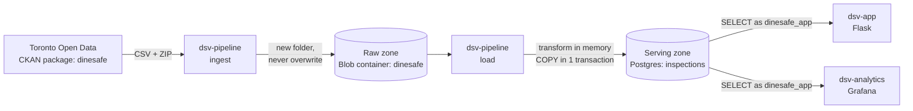
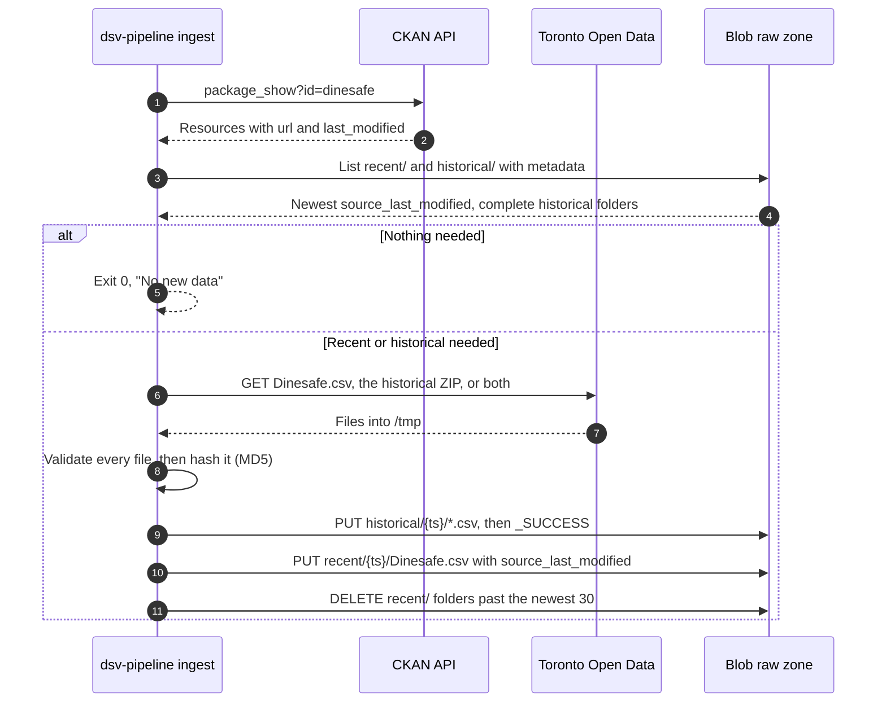

# Data architecture

How DineSafe data gets from Toronto Open Data into Postgres, how it's
transformed, how it stays current, and how the app reads it.

## Overview

Data flows one way through three zones. One one-shot service, `dsv-pipeline`,
writes. Everything else reads.



| Zone      | Where                                       | Holds                               | Writer                        | Readers                           |
| --------- | ------------------------------------------- | ----------------------------------- | ----------------------------- | --------------------------------- |
| Raw       | Blob container `dinesafe` in `stdsv<env>01` | Files as downloaded, never edited   | `ingest`                      | `load`                            |
| Transform | `dsv-pipeline` memory and `/tmp`            | Decoded, mapped, de-duplicated rows | `load`                        | `load`                            |
| Serving   | `dsv-db`, volume `dsv-db-data`              | `inspections`, `load_log`           | `load` as `dinesafe_migrator` | App and Grafana as `dinesafe_app` |

- Only `ingest` and `run` contact Toronto Open Data. Deploys run `load` only.
- The raw zone can rebuild the database at any time, without Toronto.
- `docker compose up`, `restart`, and rebuilds never change data:
  `dsv-pipeline` is in the `pipeline` profile.

### Components

Each component on the data path, and the code that defines it:

| Component                 | Code                                                | Role                                                    |
| ------------------------- | --------------------------------------------------- | ------------------------------------------------------- |
| `dsv-pipeline ingest`     | `src/dsv-db/data.py`                                | Toronto Open Data → raw zone. Never touches Postgres.   |
| `dsv-pipeline load`       | `src/dsv-db/pipeline.py`, `src/dsv-db/refresh.py`   | Raw zone → transform → Postgres. Never contacts Toronto. |
| `scripts/pipeline.sh`     | `scripts/pipeline.sh`, `scripts/lib.sh`             | Gets a storage token, then runs `dsv-pipeline`.          |
| `dsv-pipeline.timer`      | `deploy/systemd/dsv-pipeline.{timer,service}`       | Runs `pipeline.sh <env> run` on weekday mornings (VMs).  |
| `scripts/deploy.sh`       | `scripts/deploy.sh`                                 | Runs migrations, then `pipeline.sh <env> load`.          |
| `dsv-db`                  | `src/dsv-db/init.sql`, `src/dsv-db/migrations/`     | Postgres 18.6. Schema, roles, and grants.                |
| `dsv-app`                 | `src/dsv-app/app.py`                                | Web pages. Reads `inspections`.                          |
| `dsv-analytics`           | `src/dsv-analytics/provisioning/`                   | Grafana dashboard. Reads `inspections`.                  |

## How the app reads data

Two services read Postgres, both as `dinesafe_app`: `SELECT` only, with a
10-second `statement_timeout`. Neither writes.

| Reader          | Code                              | Connection                                                       | Caching                                              |
| --------------- | --------------------------------- | ---------------------------------------------------------------- | ---------------------------------------------------- |
| `dsv-app`       | `src/dsv-app/app.py`              | New psycopg2 connection per query. No pool. 5 s connect timeout. | Inspection count and date range, in memory, 5-day TTL |
| `dsv-analytics` | `src/dsv-analytics/provisioning/` | Provisioned data source `dinesafe-postgres`, `sslmode: disable`  | None. Panels query on every dashboard load.          |

- `load_log` is readable, but nothing displays it yet.
- Connections are plaintext, on the internal `backend` network only.

### Grain: one row per infraction

Both readers depend on how `inspections` stores an inspection.

| `establishment_id`   | `inspection_date` | `establishment_status` | `severity`  | `infraction_details`                              |
| -------------------- | ----------------- | ---------------------- | ----------- | ------------------------------------------------- |
| `001Vo000013QjdPIAS` | 2026-04-21        | Pass                   | M - Minor   | FAIL TO ENSURE EQUIPMENT SURFACE SANITIZED …      |
| `001Vo000013QjdPIAS` | 2026-04-21        | Pass                   | M - Minor   | FOOD PREMISE NOT MAINTAINED TO KEEP …             |
| `10500438`           | 2017-12-05        | Pass                   | `NULL`      | `NULL`                                            |

- Rows 1 and 2: one inspection with two infractions. Row 3: a clean
  inspection, one row with `NULL` infraction fields.
- An inspection is an `(establishment_id, inspection_date)` pair. Recent rows
  have no `inspection_id`.
- The app and Grafana both count `DISTINCT establishment_id, inspection_date`,
  so their totals match: about 333,000 inspections in about 508,000 rows.


## How data is ingested

`dsv-pipeline ingest` (`src/dsv-db/data.py`) copies new files from Toronto
Open Data to the raw zone. It never touches Postgres.



| Rule                | Detail                                                                                                                                                                                    |
| ------------------- | ----------------------------------------------------------------------------------------------------------------------------------------------------------------------------------------- |
| Find files          | Exact name and format: `Dinesafe.csv` (CSV) and `Dinesafe Historical Data` (ZIP). Exactly one match each, or fail. Survives resource ID changes and skips the stale `Dinesafe™.csv`.     |
| Download recent     | CKAN `last_modified` is newer than the newest blob's `source_last_modified`, `recent/` is empty, or `--force`.                                                                            |
| Download historical | No `historical/` folder has `_SUCCESS`, or `--historical`.                                                                                                                                |
| Unzip               | Every `.csv` in the ZIP, flattened to its base name. Other files are skipped.                                                                                                             |
| Validate            | Every file, before any upload: mapped headers present, UTF-8 or cp1252, at least 50,000 recent rows and 1,000 rows per historical file. Values aren't checked.                            |
| Skip duplicates     | Doesn't upload a recent file whose MD5 matches the newest blob.                                                                                                                           |
| Upload order        | Historical CSVs, `_SUCCESS`, recent CSV, then prune.                                                                                                                                      |
| Integrity           | `Content-MD5` on every upload, so Blob rejects a corrupted body.                                                                                                                          |
| Timeouts            | 120 seconds without data, per request.                                                                                                                                                    |
| Client              | Plain Blob REST API (`x-ms-version: 2023-11-03`) with a bearer token. No Azure SDK.                                                                                                       |

### Raw zone layout

Each ingest writes to new folders. Nothing is overwritten.

```text
stdsv<env>01 / dinesafe
├── recent/
│   ├── 20261009T113005Z/Dinesafe.csv   metadata: source_last_modified
│   └── 20261012T113012Z/Dinesafe.csv   ← newest: last in sort order
└── historical/
    └── 20261005T140211Z/
        ├── dinesafe_hist_2001.csv … dinesafe_hist_2023.csv
        └── _SUCCESS                     ← written last; no marker, no load
```

- Folder name: the ingest's UTC start time, not Toronto's date. Names sort in
  time order, so there's no manifest.
- A forced download with new content gets its own folder.
- A new `historical/` folder takes effect only on the next seed. Refreshes
  never read `historical/`.