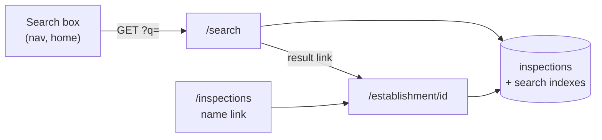

# Restaurant search

This page explains restaurant search: what it must do, and how it reads the
`inspections` table to do it. For the table itself, see
[Database schema](3-3-database.md).

## Requirements

Search answers one question: "Is this place safe?" You type part of a
restaurant's name or address, pick a match, and see every inspection it has
had.

| Requirement     | How search meets it                                                                             |
| --------------- | ----------------------------------------------------------------------------------------------- |
| One-step lookup | One search box: in the nav on every page but home, and larger in the home page hero.            |
| Full history    | Each result shows the latest result and links to the restaurant's inspection history.           |
| Simple          | Plain `GET` forms and server-rendered pages. No JavaScript, new packages, or new services.      |
| Fast            | Target: under 50 ms of database time for a typical search, on about 508,000 rows.               |
| Safe            | Read-only `dinesafe_app` with a 10-second timeout. Input is capped and sent only as parameters. |

Search doesn't do search as you type, fuzzy matching, filters, or maps. Each
can be added later without changing this design.

## Pages

Search adds two pages to the Flask app. Both reuse the existing styles, error
pages, and database connection pool.

| Route                               | Shows                                                                                      | Database work                                                 |
| ----------------------------------- | ------------------------------------------------------------------------------------------ | ------------------------------------------------------------- |
| `/search?q=pizza`                   | Up to 50 matching restaurants, each with its latest result, address, and inspection count. | One query, only when `q` has a word of 3 or more characters.  |
| `/establishment/<establishment_id>` | Every inspection for one establishment ID, newest first, in the `/inspections` day boxes.  | One lookup by ID. A malformed ID returns 404 without a query. |

On `/inspections`, each restaurant name links to its restaurant page.

## How search uses the schema

Search reads the existing `inspections` table. It adds indexes, not tables,
so the data pipeline doesn't change.

### One row per infraction

The table has one row per infraction, not one per restaurant. A restaurant's
name, address, and status repeat on each of its rows. Search groups rows like
this:

- **A restaurant** is one `establishment_id`.
- **An inspection** is one `(establishment_id, inspection_date)` pair. The
  home stats and the dashboard count it the same way.

| Column                  | Search uses it to                                                    |
| ----------------------- | -------------------------------------------------------------------- |
| `establishment_id`      | Group rows into one result, and build the restaurant page URL.       |
| `establishment_name`    | Match words, show the name, and rank results.                        |
| `establishment_address` | Match words.                                                         |
| `street`, `unit`        | Show the address on the result card.                                 |
| `establishment_status`  | Color the result card with the latest result.                        |
| `establishment_type`    | Show the type when any row has one. Rows from 2023 onward have none. |
| `inspection_date`       | Count inspections, and find the first and the latest.                |

### From query to words

The app turns `q` into search words before it touches the database (the
`/search` route and `search_terms()` in `src/dsv-app/app.py`):

1. Replace control characters with spaces, cut the query to 100 characters,
   lowercase it, and split it on whitespace.
2. Drop duplicate words and words shorter than 3 characters. Keep the first
   5.
3. Escape `\`, `%`, and `_` in each word so they match literally, then wrap
   it in `%...%` for `ILIKE` (`like_pattern()`).

For example, `Pizza Queen St` becomes `pizza` and `queen`. A restaurant
matches when one of its rows has every word, each in the name or the
address.

### The search query

One SQL statement, `_SEARCH_QUERY`, works in three steps:

1. **`ids`:** find each `establishment_id` with a row where every word is in
   the name or the address. The trigram indexes do this.
2. **`latest`:** for each ID, take its newest row for the name, street, unit,
   status, and date. The `establishment_id` index finds the rows.
3. **`totals`:** for each ID, across all its rows, count the inspections and
   find the first date and the type.

Names that start with the first word sort first, then the most recently
inspected, then name and ID. The query asks for 51 rows, so the page can say
"50+" when there are more.

The SQL text never contains user input. `psycopg2.sql` repeats one fixed
`WHERE` fragment per word, and each word goes in as a query parameter.

### Indexes

Migration `src/dsv-db/migrations/002_search_indexes.sql` adds the `pg_trgm`
extension and three indexes. `scripts/deploy.sh` and `scripts/pipeline.sh`
apply it before each load, like `001`. On a new database volume, it runs
after `init.sql` and before the first load.

| Index                                        | Type                                   | Makes this fast                      |
| -------------------------------------------- | -------------------------------------- | ------------------------------------ |
| `inspections_establishment_name_trgm_idx`    | GIN trigram on `establishment_name`    | `ILIKE '%word%'` on names            |
| `inspections_establishment_address_trgm_idx` | GIN trigram on `establishment_address` | `ILIKE '%word%'` on addresses        |
| `inspections_establishment_id_idx`           | B-tree on `establishment_id`           | Reading all of one restaurant's rows |

A trigram is a run of 3 characters. A trigram index records which rows
contain each trigram, so Postgres finds `%pizza%` without reading every row.
A word shorter than 3 characters gives the index no trigram to look up, so
search drops it.

### Known limitation: two IDs per restaurant

The city moved to new establishment IDs in 2023. The table doesn't store the
old-to-new mapping, so a restaurant open before and after 2023 can appear as
two results. Each result's first and latest dates tell them apart.

## Code map

The feature lives in these files.

| File                                           | Role                                                                                                                                               |
| ---------------------------------------------- | -------------------------------------------------------------------------------------------------------------------------------------------------- |
| `src/dsv-db/migrations/002_search_indexes.sql` | The extension and the three indexes.                                                                                                               |
| `src/dsv-app/app.py`                           | `search_terms()`, `like_pattern()`, `search_query()`, `_search_establishments()`, `_fetch_establishment()`, `build_history()`, and the two routes. |
| `src/dsv-app/templates/_search.html`           | The search form, shared by the nav and the home hero.                                                                                              |
| `src/dsv-app/templates/search.html`            | The results page.                                                                                                                                  |
| `src/dsv-app/templates/establishment.html`     | The restaurant page.                                                                                                                               |
| `tests/test_search_sql.py`                     | Runs the search query against the real Postgres image.                                                                                             |
