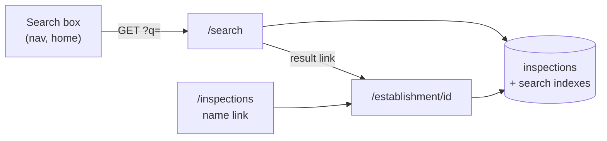

# Restaurant search

This page explains restaurant search: what it must do, and how it reads the
`inspections` table to do it. For the table itself, see
[Database schema](3-3-database.md).

## Requirements

Search answers one question: "Is this place safe?" You type part of a
restaurant's name or address, pick a match, and see every inspection it has
had.

| Requirement     | How search meets it                                                                             |
| --------------- | ----------------------------------------------------------------------------------------------- |
| One-step lookup | One search box: in the nav on every page but home, and larger in the home page hero.            |
| Full history    | Each result shows the latest result and links to the restaurant's inspection history.           |
| Simple          | Plain `GET` forms and server-rendered pages. No JavaScript, new packages, or new services.      |
| Fast            | Target: under 50 ms of database time for a typical search, on about 508,000 rows.               |
| Safe            | Read-only `dinesafe_app` with a 10-second timeout. Input is capped and sent only as parameters. |

Search doesn't do search as you type, fuzzy matching, or filters. Each can
be added later without changing this design.

## Pages

Search adds two pages to the Flask app. Both reuse the existing styles, error
pages, and database connection pool.

| Route                               | Shows                                                                                                                       | Database work                                                                                                                       |
| ----------------------------------- | --------------------------------------------------------------------------------------------------------------------------- | ----------------------------------------------------------------------------------------------------------------------------------- |
| `/search?q=pizza&page=2`            | The number of matching restaurants, and one page of 50 of them, each with its latest result, address, and inspection count. | A count and a page query, only when `q` has a word of 3 or more characters. The page query is skipped when the page would be empty. |
| `/establishment/<establishment_id>` | Every inspection for one establishment ID, newest first, in the `/inspections` day boxes.                                   | One lookup by ID. A malformed ID returns 404 without a query.                                                                       |

On `/inspections`, each restaurant name links to its restaurant page.

## How search uses the schema

Search reads the existing `inspections` table. It adds indexes, not tables,
so the data pipeline doesn't change.

### One row per infraction

The table has one row per infraction, not one per restaurant. A restaurant's
name, address, and status repeat on each of its rows. Search groups rows like
this:

- **A restaurant** is one `establishment_id`.
- **An inspection** is one `(establishment_id, inspection_date)` pair. The
  home stats and the dashboard count it the same way.

| Column                  | Search uses it to                                                    |
| ----------------------- | -------------------------------------------------------------------- |
| `establishment_id`      | Group rows into one result, and build the restaurant page URL.       |
| `establishment_name`    | Match words, show the name, and rank results.                        |
| `establishment_address` | Match words.                                                         |
| `street`, `unit`        | Show the address on the result card.                                 |
| `establishment_status`  | Color the result card with the latest result.                        |
| `establishment_type`    | Show the type when any row has one. Rows from 2023 onward have none. |
| `inspection_date`       | Count inspections, and find the first and the latest.                |

### From query to words

The app turns `q` into search words before it touches the database (the
`/search` route and `search_terms()` in `src/dsv-app/app.py`):

1. Replace control characters with spaces, cut the query to 100 characters,
   lowercase it, and split it on whitespace.
2. Drop duplicate words and words shorter than 3 characters. Keep the first
   5.
3. Escape `\`, `%`, and `_` in each word so they match literally, then wrap
   it in `%...%` for `ILIKE` (`like_pattern()`).

For example, `Pizza Queen St` becomes `pizza` and `queen`. A restaurant
matches when one of its rows has every word, each in the name or the
address.

The `page` parameter picks which 50 results to show (`parse_page()`). It
must be plain ASCII digits. A missing, empty, or `0` page, or anything else
(for example, `-1`, `+2`, `1.5`, or `²`), shows page 1.

### The count query

`_SEARCH_COUNT_QUERY` counts the matching restaurants with
`COUNT(DISTINCT establishment_id)`, using the same `WHERE` as the `ids` step
below. The results heading shows this total, for example `157 restaurants`.
The total also sets the page count: 50 per page, rounded up.

When the total is 0, or the page is past the last one, the app skips the
search query. A huge `page` never reaches Postgres as an `OFFSET`.

The count and the page are two statements, so a data load that lands between
them can shift the results by a row. That's accepted.

### The search query

One SQL statement, `_SEARCH_QUERY`, fetches one page in four steps:

1. **`ids`:** find each `establishment_id` with a row where every word is in
   the name or the address. The trigram indexes do this.
2. **`latest`:** for each ID, take its newest row for the name, street, unit,
   status, and date. The `establishment_id` index finds the rows.
3. **`page`:** sort the latest rows, skip the earlier pages, and keep the
   next 50 (`LIMIT 50 OFFSET (page - 1) * 50`). Names that start with the first
   word sort first, then the most recently inspected, then name and ID.
4. **`totals`:** for each of those 50 IDs, across all its rows, count the
   inspections and find the first date and the type.

The sort needs only the latest rows, so `totals` runs for one page, not for
every match. The limit and offset are query parameters, like the words.

The SQL text never contains user input. `psycopg2.sql` repeats one fixed
`WHERE` fragment per word, and each word goes in as a query parameter.

### Pager

When there's more than one page, a pager below the results links to the
other pages. It's plain links, server-rendered, with no JavaScript:

- A previous arrow (`‹`) and a next arrow (`›`). On the first or last page,
  the arrow is shown but isn't a link.
- The first page, the last page, and the pages next to the current one
  (`page_window()`). An ellipsis (`…`) stands in for a run of two or more
  pages; a single hidden page is shown instead.
- The current page, highlighted and not a link.

Each link keeps `q`, for example `/search?q=burger+king&page=2`. A page past
the end shows the total, "No results on page 9.", and a link to page 1.

### Indexes

Migration `src/dsv-db/migrations/002_search_indexes.sql` adds the `pg_trgm`
extension and three indexes. `scripts/deploy.sh` and `scripts/pipeline.sh`
apply it before each load, like `001`. On a new database volume, it runs
after `init.sql` and before the first load.

| Index                                        | Type                                   | Makes this fast                      |
| -------------------------------------------- | -------------------------------------- | ------------------------------------ |
| `inspections_establishment_name_trgm_idx`    | GIN trigram on `establishment_name`    | `ILIKE '%word%'` on names            |
| `inspections_establishment_address_trgm_idx` | GIN trigram on `establishment_address` | `ILIKE '%word%'` on addresses        |
| `inspections_establishment_id_idx`           | B-tree on `establishment_id`           | Reading all of one restaurant's rows |

A trigram is a run of 3 characters. A trigram index records which rows
contain each trigram, so Postgres finds `%pizza%` without reading every row.
A word shorter than 3 characters gives the index no trigram to look up, so
search drops it.

### Known limitation: two IDs per restaurant

The city moved to new establishment IDs in 2023. The table doesn't store the
old-to-new mapping, so a restaurant open before and after 2023 can appear as
two results. Each result's first and latest dates tell them apart.

## Map

The results page shows a map of Toronto above the list, with one pin for
every matching restaurant, not just the current page. The restaurant page
shows a map with one pin. Both use Leaflet 1.9.4, vendored in
`src/dsv-app/static/vendor/leaflet/`.

- **Pins:** the map query matches the same IDs as the list and sorts them the
  same way. It takes each restaurant's latest row for the name and status,
  and its newest row that has coordinates for the location. It returns up to
  `SEARCH_MAP_LIMIT` (1,000) pins. Past that, a note under the map says how
  many are shown.
- **Data:** the route writes the pins into the page as a JSON block
  (`{{ map_pins | tojson }}`). There's no map endpoint. `static/map.js`
  builds the map and the popups from that block.
- **Tiles:** visitors' browsers fetch map tiles from
  `tile.openstreetmap.org`, following the OpenStreetMap tile usage policy.
  OpenStreetMap sees the visitor's IP address and which part of the map
  they view. The server makes no outbound requests for maps.
- **Without JavaScript:** the map container stays hidden, and the list works
  as before.

## Code map

The feature lives in these files.

| File                                           | Role                                                                                                                                                                                                                                           |
| ---------------------------------------------- | ---------------------------------------------------------------------------------------------------------------------------------------------------------------------------------------------------------------------------------------------- |
| `src/dsv-db/migrations/002_search_indexes.sql` | The extension and the three indexes.                                                                                                                                                                                                           |
| `src/dsv-app/app.py`                           | `search_terms()`, `like_pattern()`, `search_count_query()`, `search_query()`, `search_map_query()`, `map_pin()`, `parse_page()`, `page_window()`, `_search_establishments()`, `_fetch_establishment()`, `build_history()`, and the two routes. |
| `src/dsv-app/templates/_search.html`           | The search form, shared by the nav and the home hero.                                                                                                                                                                                          |
| `src/dsv-app/templates/search.html`            | The results page.                                                                                                                                                                                                                              |
| `src/dsv-app/templates/establishment.html`     | The restaurant page.                                                                                                                                                                                                                           |
| `tests/test_search_sql.py`                     | Runs the count and search queries against the real Postgres image.                                                                                                                                                                             |
| `src/dsv-app/templates/_map.html`              | The map container, its JSON block, and the Leaflet tags.                                                                                                                                                                                       |
| `src/dsv-app/static/map.js`                    | Builds the map, pins, and popups.                                                                                                                                                                                                              |
| `src/dsv-app/static/vendor/leaflet/`           | Leaflet 1.9.4, pinned by checksum in `SOURCE.md`.                                                                                                                                                                                              |
| `tests/test_search_map_sql.py`                 | Runs the map query against the real Postgres image.                                                                                                                                                                                            |
