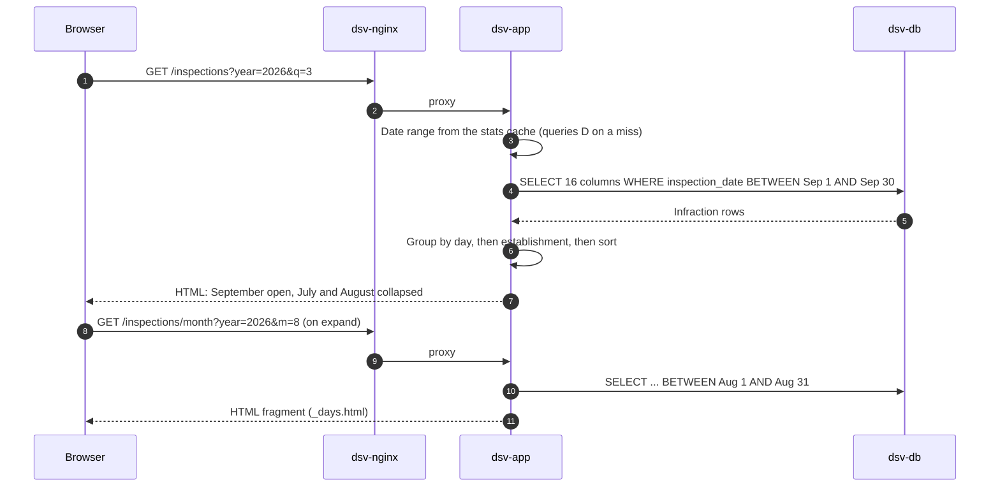

### Inspections page

The page queries one month at a time. Older months load when you expand them.

| Function               | Query                                                                  | Feeds                                        |
| ---------------------- | ---------------------------------------------------------------------- | -------------------------------------------- |
| `_get_home_stats()`    | `COUNT(*)`, `MIN` and `MAX(inspection_date)` over distinct inspections | Home and info totals, quarter picker range   |
| `_fetch_inspections()` | 16 columns `WHERE inspection_date BETWEEN start AND end`               | One month of day boxes                       |
| `readyz()`             | `SELECT 1`, 1 s connect timeout                                        | Readiness check                              |

- Page queries filter on `inspection_date`, the only secondary index. The
  stats query scans the whole table, which is why it's cached.
- Python shapes the rows, not SQL:
  - `group_establishments()`: one card per establishment per day, with
    infractions grouped by severity and category.
  - `sort_rows()`: Closed → Conditional Pass → Pass → other, then name and
    address.
  - Infractions: Crucial → Significant → Minor → other.
  - `build_days()`: one box per day in range, including empty days.
- Quarter picker: every year from the first to the last inspection date. The
  end years show only quarters with data. Invalid `year` or `q` falls back to
  the latest quarter.
- Month ranges are clipped to the first inspection date and today.

### Stats cache

`_get_home_stats()` caches the inspection count and the first and last
inspection dates. Every page reads it.

- `inject_globals()`, a context processor, builds the quarter picker from the
  cached range on every `render_template()` call, including fragments.
- One cache per process. Gunicorn runs 1 worker with 4 threads. A lock stops
  threads from filling it at the same time.
- Not cached when the table is empty or the database is down. The range then
  falls back to January 1, 2001 → today, and the next request retries.

<!-- prettier-ignore -->
> [!NOTE]
> New rows show on the inspections pages as soon as a load commits. The home
> totals and the quarter picker range lag by up to 5 days, until the cache
> expires or `dsv-app` restarts. When a new quarter starts, you can't open it
> until then.
