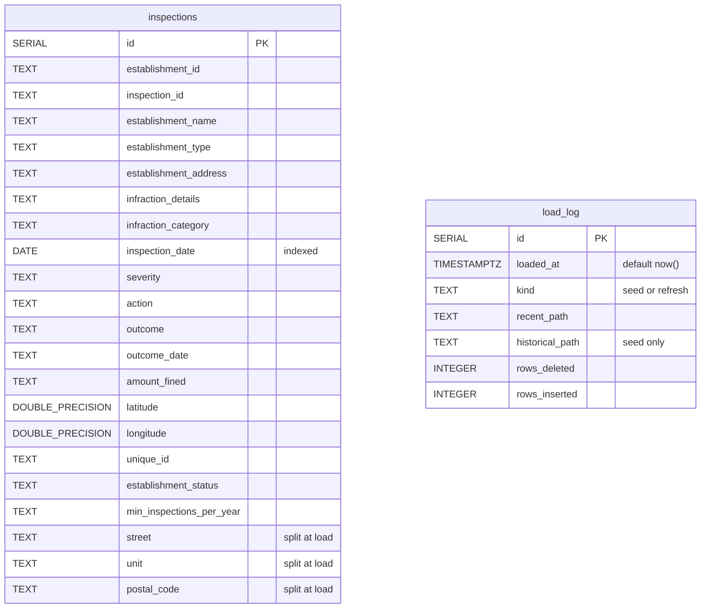

## Database schema

`src/dsv-db/init.sql` and `src/dsv-db/migrations/001_load_log.sql` define two
tables in the `public` schema of the `dinesafe` database. No foreign key
links them.

### `inspections`

One row per infraction, about 508,000 rows. Denormalized: establishment
fields repeat on every row.

In the **Read by** column, *dashboard* means the inspections dashboard
(Grafana).

| Column                     | Type             | `NULL` when                        | Read by               |
| -------------------------- | ---------------- | ---------------------------------- | --------------------- |
| `id`                       | SERIAL PK        | Never                              | —                     |
| `establishment_id`         | TEXT             | Never                              | App, stats, dashboard |
| `inspection_id`            | TEXT             | Recent rows                        | —                     |
| `establishment_name`       | TEXT             | Never                              | App                   |
| `establishment_type`       | TEXT             | Recent rows                        | App, dashboard        |
| `establishment_address`    | TEXT             | Never                              | App (sort tiebreak)   |
| `infraction_details`       | TEXT             | Clean inspection                   | App, dashboard        |
| `infraction_category`      | TEXT             | Historical rows, clean inspection  | App, dashboard        |
| `inspection_date`          | DATE             | Never                              | App, stats, dashboard |
| `severity`                 | TEXT             | Clean inspection                   | App, dashboard        |
| `action`                   | TEXT             | Recent rows, clean inspection      | App                   |
| `outcome`                  | TEXT             | No prosecution (about 99% of rows) | App                   |
| `outcome_date`             | TEXT             | Historical rows, no outcome        | App                   |
| `amount_fined`             | TEXT             | No fine                            | App                   |
| `latitude`, `longitude`    | DOUBLE PRECISION | Never                              | —                     |
| `unique_id`                | TEXT             | Historical rows                    | —                     |
| `establishment_status`     | TEXT             | Never                              | App, dashboard        |
| `min_inspections_per_year` | TEXT             | Recent rows                        | —                     |
| `street`                   | TEXT             | Never                              | App                   |
| `unit`                     | TEXT             | No unit found (about 78% of rows)  | App                   |
| `postal_code`              | TEXT             | Historical rows, recent `None`     | App                   |

- "Never" is observed in the data, not enforced: every column except `id` is
  nullable.
- App = `_fetch_inspections()`. Stats = `_get_home_stats()`.
- `unique_id` is `NULL` for every historical row, so `unique_id IS NULL`
  selects the historical era.

### `load_log`

One row per successful seed or refresh. The newest row records what's loaded.

| Column            | Type        | Notes                                                           |
| ----------------- | ----------- | --------------------------------------------------------------- |
| `id`              | SERIAL PK   | Newest row = highest `id`                                       |
| `loaded_at`       | TIMESTAMPTZ | `NOT NULL`, defaults to `now()`                                 |
| `kind`            | TEXT        | `NOT NULL`, `CHECK (kind IN ('seed', 'refresh'))`               |
| `recent_path`     | TEXT        | `NOT NULL`. For example, `recent/20261012T113012Z/Dinesafe.csv` |
| `historical_path` | TEXT        | Seed only. For example, `historical/20261005T140211Z/`          |
| `rows_deleted`    | INTEGER     | `NOT NULL`. Always 0 for a seed.                                |
| `rows_inserted`   | INTEGER     | `NOT NULL`                                                      |

- `load()` compares the newest `recent_path` with the newest blob to decide
  whether to skip.

### Indexes and constraints

The schema is minimal: one secondary index and no data constraints on
`inspections`.

- `inspections_inspection_date_idx` on `inspection_date`. Every app, refresh,
  and inspections dashboard (Grafana) query
  filters on it.
- Primary keys on both `id` columns. No unique, `NOT NULL`, or `CHECK`
  constraints on `inspections`.

### Roles and grants

Three roles. The pipeline and readers never use the superuser.

| Role                                   | `inspections`, `load_log`    | Other                                                                             |
| -------------------------------------- | ---------------------------- | --------------------------------------------------------------------------------- |
| Superuser (`DSV_DB_USER`, `dsv_admin`) | Owner                        | Runs `init.sql` and every migration.                                              |
| `dinesafe_migrator`                    | `SELECT`, `INSERT`, `DELETE` | `USAGE` on both sequences. No `UPDATE`, `TRUNCATE`, `CREATE`, or `DROP`.          |
| `dinesafe_app`                         | `SELECT`                     | `statement_timeout = 10s`. Default privileges grant it `SELECT` on future tables. |

- No `UPDATE` grant, so the pipeline changes data only by delete and insert.

### Schema lifecycle

Postgres creates the schema once. Deploys keep it current.

1. On the first start of an empty `dsv-db-data` volume, the Postgres image
   runs, in name order: `init.sql`, `migrations-001_load_log.sql`, then
   `set-passwords.sh`.
2. On every deploy, `deploy.sh` reruns each `src/dsv-db/migrations/*.sql` as
   the superuser. Migrations are idempotent.
3. `dsv-pipeline load` fills the tables.

- `DSV_DB_NAME` must be `dinesafe`, because `init.sql` grants on that name.
- `set-passwords.sh` runs only on a new volume. Changing a password later
  needs `ALTER ROLE`.
