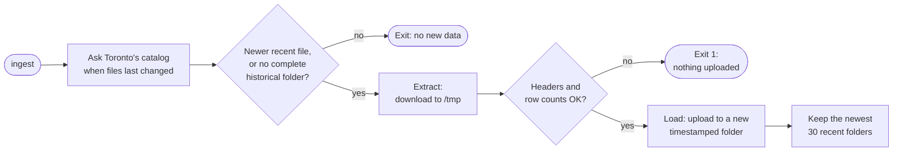
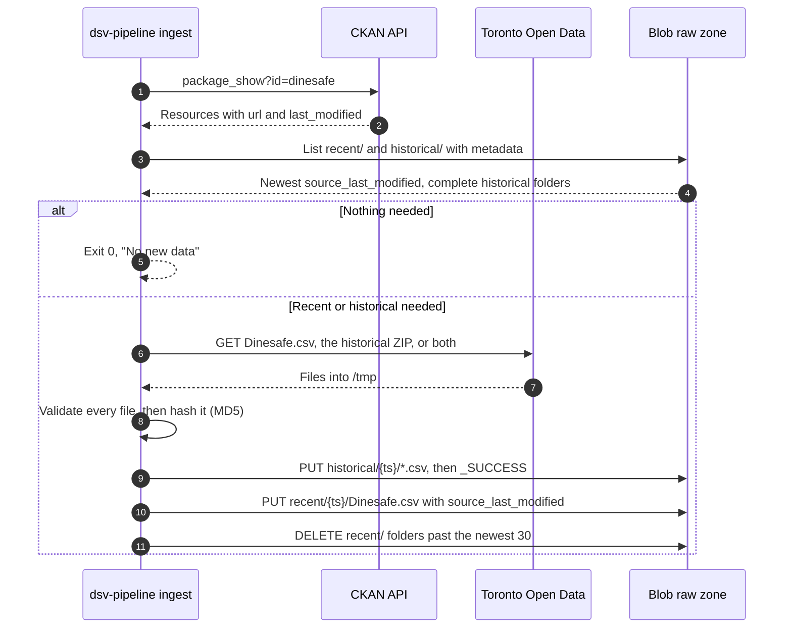

# Ingest pipeline

This page describes the `ingest` pipeline. It copies new files from Toronto
Open Data into the raw zone, the Azure Blob container `dinesafe`. It never
touches Postgres. For the overview of all three pipelines, see
[Data architecture](3-1-data-architecture.md).

## Summary

The `ingest` pipeline moves data from Toronto into the bronze layer.

| Property         | Value                                                           |
| ---------------- | --------------------------------------------------------------- |
| From → to        | Toronto Open Data → bronze (Blob raw zone)                      |
| Code             | `src/dsv-db/data.py: ingest`                                    |
| Contacts Toronto | Yes                                                             |
| Touches Postgres | No                                                              |
| Environments     | stg and prod only. dev can't ingest; it loads from stg's raw zone |

## Triggers

The timer and operators start ingest. Deploys never ingest, so an Open Data
outage can't block a deploy.

| Trigger                          | Command                                             | Downloads                         |
| -------------------------------- | --------------------------------------------------- | --------------------------------- |
| `dsv-pipeline.timer` (stg, prod) | `pipeline.sh <env> run`                             | If Toronto has newer files        |
| Operator                         | `pipeline.sh <env> run --force`                     | Always downloads the recent CSV   |
| Operator                         | `pipeline.sh <env> ingest [--force] [--historical]` | If newer, or as the flags request |

- In `run`, ingest is the first step. If it fails, `run` stops: no load and
  no staleness check.
- `--force` downloads the recent CSV even if Toronto's `last_modified` isn't
  newer. `run --force` forces the download, not the load.
- `--historical` downloads the historical ZIP again.
- If the raw zone has no complete historical folder, ingest downloads the
  historical ZIP too. You don't need a separate step for it.

<!-- prettier-ignore -->
> [!IMPORTANT]
> When setting up a new stg or prod environment, you must ingest before the
> first deploy. Run `scripts/pipeline.sh <env> ingest`, then
> `scripts/deploy.sh`. dev loads from stg's raw zone, so stg must be ingested
> first.

## Flow

At a high level, ingest checks Toronto's catalog, downloads only what's new,
validates it, and uploads it to a new folder.



The same flow, call by call:



## Rules

These rules decide what ingest downloads, accepts, and uploads.

| Rule                | Detail                                                                                                                                                                                |
| ------------------- | ------------------------------------------------------------------------------------------------------------------------------------------------------------------------------------- |
| Find files          | Exact name and format: `Dinesafe.csv` (CSV) and `Dinesafe Historical Data` (ZIP). Exactly one match each, or fail. Survives resource ID changes and skips the stale `Dinesafe™.csv`. |
| Download recent     | CKAN `last_modified` is newer than the newest blob's `source_last_modified`, `recent/` is empty, or `--force`.                                                                        |
| Download historical | No `historical/` folder has `_SUCCESS`, or `--historical`.                                                                                                                            |
| Unzip               | Every `.csv` in the ZIP, flattened to its base name. Other files are skipped.                                                                                                         |
| Validate            | Every file, before any upload: mapped headers present, UTF-8 or cp1252, at least 50,000 recent rows and 1,000 rows per historical file. Values aren't checked.                        |
| Skip duplicates     | Doesn't upload a recent file whose MD5 matches the newest blob.                                                                                                                       |
| Upload order        | Historical CSVs, `_SUCCESS`, recent CSV, then prune. No recent upload, no prune.                                                                                                      |
| Integrity           | `Content-MD5` on every upload, so Blob rejects a corrupted body.                                                                                                                      |
| Timeouts            | 120 seconds without data, per request.                                                                                                                                                |
| Client              | Plain Blob REST API (`x-ms-version: 2023-11-03`) with a bearer token. No Azure SDK.                                                                                                   |

For the files themselves, including why `Dinesafe™.csv` must be skipped, see
[Data sources](3-2-data-sources.md).

## Raw zone layout

Each ingest writes to new folders. Nothing is overwritten.

```text
stdsv<env>01 / dinesafe
├── recent/
│   ├── 20261009T113005Z/Dinesafe.csv   metadata: source_last_modified
│   └── 20261012T113012Z/Dinesafe.csv   ← newest: last in sort order
└── historical/
    └── 20261005T140211Z/
        ├── dinesafe_hist_2001.csv … dinesafe_hist_2023.csv
        └── _SUCCESS                     ← written last; no marker, no load
```

- Folder name: the ingest's UTC start time, not Toronto's date. Names sort in
  time order, so there's no manifest.
- A forced download with new content gets its own folder.
- A new `historical/` folder takes effect only on the next seed. Refreshes
  never read `historical/`. See [Seed pipeline](datapipe-seed.md).

## Retention

The raw zone is the only backup of the data. Postgres has no backup of its
own, so the seed rebuilds the database from these folders.

| Data                   | Kept    | How                                                          |
| ---------------------- | ------- | ------------------------------------------------------------ |
| `recent/` folders      | Newest 30 | `prune_recent()` after each recent upload. Never the newest. |
| `historical/` folders  | All     | Never pruned                                                 |
| Deleted blobs          | 7 days  | Soft delete                                                  |
| Previous blob versions | 30 days | Versioning, plus lifecycle rule `delete-old-versions`        |

- Because only 30 recent folders are kept, you can't rebuild from a recent
  file older than that.
- At 30 folders, `recent/` is about 1.4 GB. Each recent CSV is about 45 MB.

## Access and credentials

Ingest writes to Blob with the VM's managed identity. It's the only service
that can reach the internet.

| Hop                         | Identity                                | Credential                              | Permission                                            |
| --------------------------- | --------------------------------------- | --------------------------------------- | ----------------------------------------------------- |
| Pipeline → Blob (stg, prod) | VM managed identity `id-dsv-<env>01-vm` | IMDS token for `storage.azure.com` only | Storage Blob Data Contributor on container `dinesafe` |

- **Token:** `pipeline.sh` mints it on the host for each run, mounts it at
  `/run/secrets/storage-token` (mode 600), and deletes it on exit. Never an
  argument or environment variable.
- **No tokens from containers:** `dsv-imds-block.service` drops container
  traffic to IMDS.
- **Storage account:** Entra ID only (shared keys off), no public blobs, TLS
  1.2, default-deny firewall with `--bypass None`. Allows the VM subnet and
  the operator's home IP.
- **Network:** `dsv-pipeline` is the only service on both `egress` and
  `backend`. The app and the inspections dashboard (Grafana) can't reach the
  internet.

## Environments

stg and prod each ingest into their own storage account. dev has no raw zone
of its own.

|                   | dev                     | stg                    | prod                   |
| ----------------- | ----------------------- | ---------------------- | ---------------------- |
| Raw zone          | `stdsvstg01`, read-only | `stdsvstg01`           | `stdsvprod01`          |
| Can ingest        | No                      | Yes                    | Yes                    |
| Timer             | No                      | Yes                    | Yes                    |
| Network isolation | None (default network)  | `egress` and `backend` | `egress` and `backend` |

- stg and prod each ingest on their own, so they can briefly serve different
  data.

## Failure handling

A failed ingest uploads nothing, so the raw zone and the site keep their last
good data.

| Failure                                                   | Result                           | Site serves    |
| --------------------------------------------------------- | -------------------------------- | -------------- |
| Toronto Open Data down, CKAN changed, or validation fails | Nothing uploaded. `run` exits 1. | Last good load |
| Blob unreachable: firewall, token, or role                | `run` exits 1                    | Last good load |
| Run takes over 30 minutes                                 | systemd stops it                 | Last good load |

| Situation      | Fix                                                |
| -------------- | -------------------------------------------------- |
| Raw zone empty | Run `pipeline.sh <env> ingest`, then deploy again. |

## Known gaps

These limits exist in the current code:

- **Shallow validation:** headers and row counts only. A valid-looking but
  wrong file replaces the recent window on the next refresh, until a good one
  arrives.
- **No alerting:** a failed run shows only as a `failed` unit and in the
  journal.
- **No disaster recovery for the raw zone:** the raw zone can rebuild the
  database, but losing the storage account itself has no recovery plan.

## Next steps

- [Seed pipeline](datapipe-seed.md): how the raw zone fills an empty
  database.
- [Refresh pipeline](datapipe-refresh.md): how the newest recent file
  replaces the recent window.
