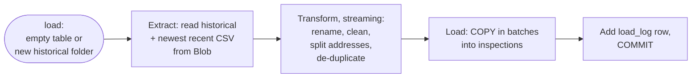
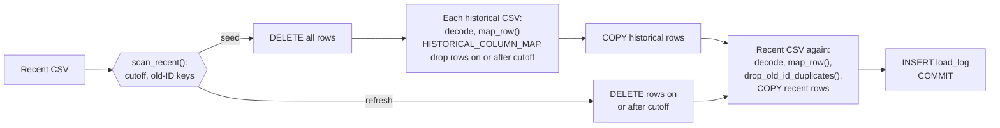

# Seed pipeline

This page describes the `seed` pipeline. It fully loads the Postgres
`inspections` table from the raw zone when the table is empty, or when the
raw zone has a historical folder the last seed didn't use. For the
overview of all three pipelines, see
[Data architecture](3-1-data-architecture.md).

## Summary

The `seed` pipeline moves data from the bronze layer into the silver layer,
once per database.

| Property         | Value                                                     |
| ---------------- | --------------------------------------------------------- |
| From → to        | Bronze (Blob raw zone) → silver (`inspections`)           |
| Code             | `src/dsv-pipeline/pipeline.py: load` → `loader.py: seed`  |
| Contacts Toronto | No                                                        |
| Runs when        | `inspections` is empty, or a new `historical/` folder     |
| Reads            | Newest complete `historical/` folder and newest `recent/` CSV |

## Triggers

You don't start a seed directly. The load step picks seed, refresh, or skip
from the state of the database. It picks seed when `inspections` is empty,
or when the newest complete `historical/` folder isn't the one the last seed
used. For the decision itself, see
[Load decision](datapipe-refresh.md#load-decision).

| Trigger                          | Command                     | Seeds when                     |
| -------------------------------- | --------------------------- | ------------------------------ |
| `deploy.sh stg`, `prod`, `dev`   | `pipeline.sh <env> load`    | First deploy on a new volume   |
| `dsv-pipeline.timer` (stg, prod) | `pipeline.sh <env> run`     | Empty table or new historical folder |
| Operator                         | `pipeline.sh <env> load`    | Empty table or new historical folder |

- A fresh deployment of the app triggers a seed, because Postgres creates an
  empty schema on the first start of a new `dsv-db-data` volume.
- `ingest --historical` writes a new `historical/` folder, so the next load
  reseeds: it deletes every row and seeds again, in one transaction.
- dev seeds from stg's raw zone.

## Prerequisites

The seed reads only from the raw zone, so the raw zone must be filled first.

- `recent/` must have at least one folder. Otherwise the load fails with
  `recent/ is empty. Run ingest first`.
- `historical/` must have a complete folder, one with `_SUCCESS`. Otherwise
  the seed fails. Run `pipeline.sh <env> ingest --historical` first.

<!-- prettier-ignore -->
> [!IMPORTANT]
> When setting up a new stg or prod environment, you must ingest before the
> first deploy. If the raw zone is empty, the first deploy's load fails and
> the deploy fails with an empty database. See
> [Ingest pipeline](datapipe-ingest.md).

## Flow

At a high level, the seed streams both datasets through the transforms into
`COPY`, in one transaction. Memory holds one batch of rows, not a file.

In detail, the seed handles the recent CSV first, because its earliest date
sets the cutoff for the historical rows:

1. Take the advisory lock, so only one load runs.
2. Download the newest recent CSV into a temporary directory.
3. Scan the recent CSV once (`scan_recent()`). This finds the cutoff, the
   earliest `inspection_date` (2023-11-10 with the current feed), and the
   old-ID duplicates to drop.
4. Delete every row in `inspections`. On a new volume, this deletes nothing.
5. Load each historical CSV in file name order. Download it, stream its rows,
   drop rows on or after the cutoff, `COPY` the rest, then delete the file.
   `/tmp` holds one historical file at a time.
6. Stream the recent CSV again, drop the old-ID duplicates, and `COPY` it.
7. Insert a `load_log` row with `kind = 'seed'`, the rows deleted and
   inserted, and both `recent_path` and `historical_path`, then commit.

`seed()` never commits. `pipeline.py` adds the `load_log` row and commits
once.

## Transformations

Seed and refresh run the same row transforms from
`src/dsv-pipeline/loader.py`.
The seed is the only pipeline that runs the historical side.

Every row goes through these steps, in order:

| #   | Step      | Code                       | Before → after                                                                  |
| --- | --------- | -------------------------- | ------------------------------------------------------------------------------- |
| 1   | Decode    | `csv_encoding()`           | UTF-8 (BOM-tolerant), else cp1252. Only the 2023 historical file is cp1252.     |
| 2   | Rename    | `map_row()`                | `estId` → `establishment_id`                                                    |
| 3   | Fill gaps | `map_row()`                | The other era's columns → `NULL`                                                |
| 4   | Nulls     | `normalize()`              | `"None"` or `""` → `NULL`                                                       |
| 5   | Dates     | `normalize_date()`         | `10/24/2023` → `2023-10-24` (2023 historical file only)                         |
| 6   | Address   | `split_address()`          | `3155 Markham Rd Unit-D1 M1X 0B5` → `3155 Markham Rd`, `Unit-D1`, `M1X 0B5`     |
| 7   | De-dupe   | `drop_old_id_duplicates()` | Drops the numeric-ID copy of a recent inspection: 3,996 rows                    |
| 8   | Overlap   | `exclude_on_or_after()`    | Drops historical rows on or after the cutoff: 4,791 rows                        |
| 9   | Escape    | `bulk_insert()`            | Tab, CR, LF in values → space. `NULL` → `\N`. Batches of 10,000 rows.           |
| 10  | Cast      | Postgres `COPY`            | Text → `DATE` or `DOUBLE PRECISION`. One bad value fails the load.              |

- Row counts are from the October 14, 2026 data.
- Overlap rule: the cutoff is the earliest date in the recent CSV. De-dupe
  can't change it, because every dropped row shares its date with a kept
  row. Rows with no date are kept.

For the full column mapping, the address split, and a worked example, see
[Data mapping](3-6-data-mapping.md).

## Size

The seed is the largest load. Measured with the October 15, 2026 data:

| Measure          | Value                                                     |
| ---------------- | --------------------------------------------------------- |
| Rows inserted    | 508,618: 390,835 historical, 117,783 recent               |
| Time             | About 24 seconds                                          |
| `/tmp`           | The recent CSV and one historical CSV at a time           |
| Memory peak      | 121 MiB, `/tmp` included, under the 256 MiB container limit |

Before streaming (October 14, 2026), the same seed peaked at 573 MiB.

## Guarantees and failure handling

The seed is one transaction. If it fails, nothing is committed and the table
keeps the rows it had: none on a first deploy, the old data on a reseed.

| Failure                                        | Result                                    |
| ---------------------------------------------- | ----------------------------------------- |
| No complete `historical/` folder               | Load fails. Run `ingest --historical`.    |
| `recent/` is empty                             | Load fails. Run `ingest`.                 |
| Load fails partway, including out of memory    | Rollback. No `load_log` row.              |
| Bad value in a typed column (date, coordinate) | `COPY` fails, rollback.                   |
| Deploy's load fails, table is empty            | Deploy fails. The site serves nothing.    |

The advisory lock, atomic commit, and skip check work the same as for a
refresh. See [Guarantees](datapipe-refresh.md#guarantees).

## Recovery

A seed is how you rebuild the database. Postgres has no backup of its own, so
the raw zone is the source for every rebuild.

| Situation                        | Fix                                                                  |
| -------------------------------- | -------------------------------------------------------------------- |
| Database lost, or a new VM       | Deploy, or run `pipeline.sh <env> load`. Seeds from the raw zone.    |
| Database volume destroyed        | The next deploy is a first deploy, so it seeds.                      |
| Transform bug in historical rows | Empty `inspections`, then `load` to reseed. No script does this yet. |

- Prod also takes a manual OS disk snapshot before each deploy.
- A new `historical/` folder triggers a reseed on the next load. Refreshes
  never read `historical/`.

## Known gaps

These limits exist in the current code:

- **Transform changes don't reach historical rows:** a refresh only replaces
  the recent window. To apply a transform change to rows before the cutoff
  (currently November 10, 2023), you must reseed.
- **No reseed command:** to reseed from the same files, run
  `pipeline.sh <env> ingest --historical` (stg and prod), which writes a new
  `historical/` folder. Or destroy the database volume and redeploy.
- **No `Closed` status before the cutoff:** historical data has no closures,
  so closure counts start in November 2023.

## Next steps

- [Refresh pipeline](datapipe-refresh.md): how later loads keep the recent
  window current.
- [Database](3-5-database.md): the `inspections` and `load_log` schema.
