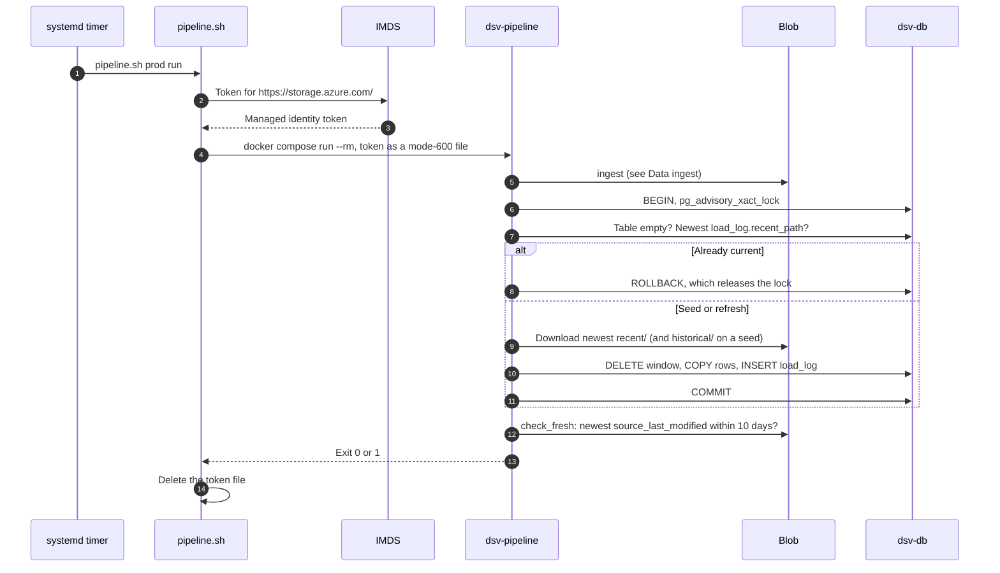
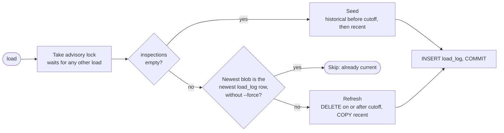

## How data is refreshed

A refresh is `pipeline.sh <env> run`: ingest, load, then a staleness check.
Deploys run the load step only.

### Triggers

Every trigger runs the same code through `scripts/pipeline.sh`.

| Trigger                          | Command                                             | Toronto Open Data | Load                                    |
| -------------------------------- | --------------------------------------------------- | ----------------- | --------------------------------------- |
| `dsv-pipeline.timer` (stg, prod) | `pipeline.sh <env> run`                             | If newer          | If there's a new blob                   |
| `deploy.sh stg`, `prod`, `dev`   | `pipeline.sh <env> load`                            | Never             | Seed, refresh, or skip                  |
| Operator                         | `pipeline.sh <env> run --force`                     | Always downloads  | If the content changed                  |
| Operator                         | `pipeline.sh <env> ingest [--force] [--historical]` | Yes               | No                                      |
| Operator                         | `pipeline.sh <env> load [--force]`                  | Never             | Yes. `--force` reloads the newest blob. |

- Timer: `Mon..Fri 07:30 America/Toronto`, plus up to 10 minutes of random
  delay. `Persistent=true` runs a missed start at the next boot. systemd stops
  a run after 30 minutes.
- `run --force` forces the download, not the load.
- Dev can only `load`, from stg's raw zone.

### End to end

A scheduled run on the VM, from timer to exit code:



- If ingest fails, `run` stops: no load and no staleness check.

### Load decision

`pipeline.load()` picks seed, refresh, or skip from `inspections` and
`load_log`.



- A seed fails if `historical/` has no complete folder. Run
  `pipeline.sh <env> ingest --historical` first.
- The skip check compares blob paths, not content.

### The recent window

A refresh replaces everything from the cutoff onward with the newest recent
CSV.

```text
inspection_date ──────────────────────────────────────────────────────────▶
2001-01-01                         cutoff                              today
│◀──────────── historical ───────────▶│◀───────── recent window ─────────▶│
  Loaded on seed. Never touched again. │  Every refresh:
  Rows on or after the cutoff are      │  DELETE WHERE inspection_date >= cutoff
  dropped as overlap.                  │  then COPY the whole recent CSV
                                       │
                         cutoff = earliest inspectionDate in the recent CSV
                                  (2023-11-10 with the current feed)
```

- Picks up Toronto's corrections, deletions, and backfill anywhere in the
  window, not just new rows.
- The cutoff follows each file. If Toronto trims the window, rows before the
  new cutoff stay as last loaded.

### Guarantees

The load's design gives readers these properties:

- **Atomic:** the delete, the insert, and the `load_log` row commit together.
  Readers see the old rows until `COMMIT`, then the new ones, and aren't
  blocked.
- **Idempotent:** loading the same blob again skips.
- **Serialized:** the advisory lock (`0x44535640AD`) makes a deploy's load and
  the timer's load take turns. The second sees the first's `load_log` row and
  skips.
- **Isolated from Toronto:** deploys and dev never ingest, so an Open Data
  outage only makes data older.

### Size

Measured with the October 14, 2026 data, unless noted:

| Measure                | Value                                                        |
| ---------------------- | ------------------------------------------------------------ |
| Seed                   | 508,445 rows: 390,835 historical, 117,610 recent             |
| Refresh                | Deletes and inserts about 117,600 rows                       |
| Recent CSV             | About 45 MB                                                  |
| Seed download          | About 125 MB, held in `/tmp`                                 |
| Seed memory peak       | About 430 MiB, under the 768 MiB container limit             |
| `inspections` on disk  | About 136 MB: 120 MB table, 15 MB indexes (October 5, 2026)  |
| `recent/`              | About 1.4 GB at 30 folders                                   |

- Each refresh leaves about 117,600 dead rows. Autovacuum, on by default,
  reclaims them.
- Each refresh uses about 117,600 new `id` values. At one refresh per weekday,
  `SERIAL` lasts about 70 years.


## Operations

Access, failures, recovery, and environments for the data path.

### Access and credentials

Each hop on the data path uses its own identity, with the least access it
needs.

| Hop                         | Identity                                         | Credential                              | Permission                                            |
| --------------------------- | ------------------------------------------------ | --------------------------------------- | ----------------------------------------------------- |
| Pipeline → Blob (stg, prod) | VM managed identity `id-dsv-<env>01-vm`          | IMDS token for `storage.azure.com` only | Storage Blob Data Contributor on container `dinesafe` |
| Pipeline → Blob (dev)       | `dsv-ops01`, through `sg-dsv-stg01-operators`    | `az account get-access-token`           | Storage Blob Data Reader on stg's container           |
| Pipeline → Postgres         | `dinesafe_migrator`                              | Key Vault secret → `.env`               | `SELECT`, `INSERT`, `DELETE` on both tables           |
| App, Grafana → Postgres     | `dinesafe_app`                                   | Key Vault secret → `.env`               | `SELECT` on both tables, 10 s timeout                 |

- **Token:** minted on the host for each run, mounted at
  `/run/secrets/storage-token` (mode 600), and deleted on exit. Never an
  argument or environment variable.
- **No tokens from containers:** `dsv-imds-block.service` drops container
  traffic to IMDS.
- **Storage account:** Entra ID only (shared keys off), no public blobs, TLS
  1.2, default-deny firewall with `--bypass None`. Allows the VM subnet and
  the operator's home IP.
- **Network:** `dsv-pipeline` is the only service on both `egress` and
  `backend`. The app and Grafana can't reach the internet.

### Failure handling

Every pipeline failure leaves the site serving its last good load, unless the
database is empty.

| Failure                                                   | Result                                                   | Site serves    |
| --------------------------------------------------------- | -------------------------------------------------------- | -------------- |
| Toronto Open Data down, CKAN changed, or validation fails | Nothing uploaded. `run` exits 1.                         | Last good load |
| Blob unreachable: firewall, token, or role                | `load` or `run` exits 1                                  | Last good load |
| Load fails partway, including out of memory               | Rollback. No `load_log` row.                             | Last good load |
| Bad value in a typed column (date, coordinate)            | `COPY` fails, rollback. Repeats until Toronto fixes it.  | Last good load |
| Newest source data over 10 days old                       | `run` loads what it has, then exits 1                    | Newest load    |
| Deploy's load fails, table has rows                       | Deploy warns and continues                               | Last good load |
| Deploy's load fails, table is empty                       | Deploy fails                                             | Nothing        |
| Run takes over 30 minutes                                 | systemd stops it                                         | Last good load |
| Postgres down                                             | `/inspections` returns 500. `/` works only while stats are cached. `/info` renders, with totals only if cached. `/readyz` returns 503. | Partial |

### Retention and recovery

The raw zone is the only backup of the data. Postgres has no backup of its
own.

| Data                   | Kept                        | How                                                          |
| ---------------------- | --------------------------- | ------------------------------------------------------------ |
| `recent/` folders      | Newest 30                   | `prune_recent()` after each recent upload. Never the newest. |
| `historical/` folders  | All                         | Never pruned                                                 |
| Deleted blobs          | 7 days                      | Soft delete                                                  |
| Previous blob versions | 30 days                     | Versioning, plus lifecycle rule `delete-old-versions`        |
| Postgres               | Until the volume is removed | Rebuilt from the raw zone. Prod: manual OS disk snapshot before each deploy. |

| Situation                        | Fix                                                                  |
| -------------------------------- | -------------------------------------------------------------------- |
| Database lost, or a new VM       | Deploy, or run `pipeline.sh <env> load`. Seeds from the raw zone.    |
| Raw zone empty                   | Run `pipeline.sh <env> ingest`, then deploy again.                   |
| Transform bug in recent rows     | Fix and deploy, then run `pipeline.sh <env> load --force`.           |
| Transform bug in historical rows | Empty `inspections`, then `load` to reseed. No script does this yet. |

### Environments

The pipeline runs the same code everywhere, with different storage and
identity.

|                   | dev                         | stg                             | prod                       |
| ----------------- | --------------------------- | ------------------------------- | -------------------------- |
| Raw zone          | `stdsvstg01`, read-only     | `stdsvstg01`                    | `stdsvprod01`              |
| Commands          | `load`                      | `ingest`, `load`, `run`         | `ingest`, `load`, `run`    |
| Timer             | No                          | Yes                             | Yes                        |
| Storage token     | Your `az login`             | VM managed identity             | VM managed identity        |
| Pipeline image    | Built from the working tree | GHCR `dsv-init-db:sha-<commit>` | GHCR `dsv-init-db:<X.Y.Z>` |
| Network isolation | None (default network)      | `egress` and `backend`          | `egress` and `backend`     |

- stg and prod each ingest on their own, so they can briefly serve different
  data.
- Dev also needs your home IP in stg's storage firewall.

### Check the pipeline

To check the pipeline on a VM, run these from the repo directory:

```bash
systemctl list-timers dsv-pipeline.timer               # next and last run
systemctl status dsv-pipeline.service                  # last result
journalctl -u dsv-pipeline.service -n 50 --no-pager    # last run's output
docker compose exec -T dsv-db sh -c 'psql -U "$POSTGRES_USER" -d "$POSTGRES_DB"' <<'SQL'
SELECT loaded_at, kind, recent_path, rows_deleted, rows_inserted
FROM load_log ORDER BY id DESC LIMIT 5;
SQL
```

### Known gaps

These limits exist in the current code:

- **No alerting:** a failed run shows only as a `failed` unit and in the
  journal.
- **Shallow validation:** headers and row counts only. A valid-looking but
  wrong file replaces the window until a good one arrives.
- **`NULL` dates:** a recent row with no `inspectionDate` would be inserted on
  every refresh and never deleted, because `DELETE ... >= cutoff` skips
  `NULL`. No such rows exist today.
- **No stable row key:** refresh reinserts recent rows with new `id` values.
  `unique_id` is recent only and isn't unique-constrained.
- **Unused columns:** `latitude`, `longitude`, `unique_id`, `inspection_id`,
  and `min_inspections_per_year` are stored but nothing reads them.
- **Dashboard note is wrong:** the Grafana text panel says establishment type
  runs to 2023-12-31. The data ends on 2023-11-09.
- **No reseed script:** fixing historical rows needs a manual empty and
  reload.
