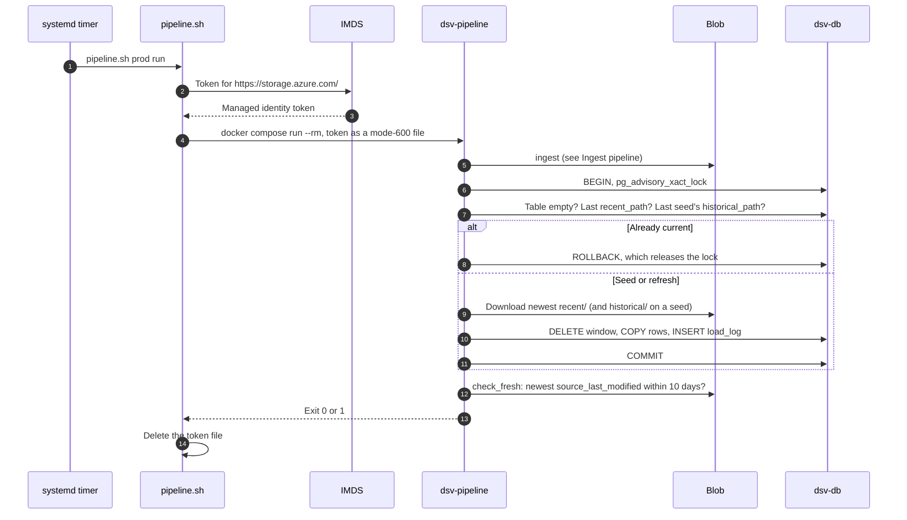
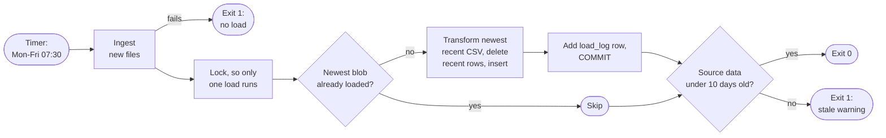
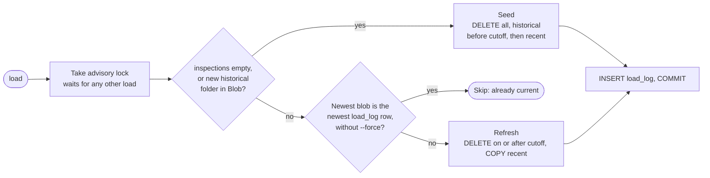

# Refresh pipeline

This page describes the `refresh` pipeline. It replaces the recent rows in
the Postgres `inspections` table with the newest recent CSV from the raw
zone. For the overview of all three pipelines, see
[Data architecture](3-1-data-architecture.md).

## Summary

The `refresh` pipeline keeps the silver layer current on weekday mornings,
right after ingest.

| Property         | Value                                                         |
| ---------------- | ------------------------------------------------------------- |
| From → to        | Bronze (Blob raw zone) → silver (`inspections`)               |
| Code             | `src/dsv-pipeline/pipeline.py: load` → `loader.py: refresh`   |
| Contacts Toronto | No                                                            |
| Runs when        | The load step finds the newest blob not loaded yet, or `--force` |
| Reads            | Newest `recent/` CSV only. Never `historical/`.               |

## Triggers

Every trigger runs the same code through `scripts/pipeline.sh`. The load step
decides whether a refresh happens.

| Trigger                          | Command                         | Refreshes                                |
| -------------------------------- | ------------------------------- | ---------------------------------------- |
| `dsv-pipeline.timer` (stg, prod) | `pipeline.sh <env> run`         | After ingest, if there's a new blob      |
| `deploy.sh stg`, `prod`, `dev`   | `pipeline.sh <env> load`        | If there's a new blob                    |
| Operator                         | `pipeline.sh <env> run --force` | If the forced download had new content   |
| Operator                         | `pipeline.sh <env> load --force` | Always. Reloads the newest blob.        |

- Timer: `Mon..Fri 07:30 America/Toronto`, plus up to 10 minutes of random
  delay. `Persistent=true` runs a missed start at the next boot. systemd stops
  a run after 30 minutes.
- `run --force` forces the download, not the load.
- dev can only `load`, from stg's raw zone.

## End to end

A scheduled run on the VM, from timer to exit code:



The same run, as a flow:



- If ingest fails, `run` stops: no load and no staleness check.
- The staleness check fails the run if the newest source data is over 10 days
  old, even after a successful load.

## Load decision

`pipeline.load()` picks seed, refresh, or skip from `inspections` and
`load_log`. Seed and refresh share this step.



- The skip check compares blob paths, not content.
- "New historical folder" means the newest complete `historical/` folder
  isn't the `historical_path` of the last seed. `--force` never skips a
  needed reseed.
- For the seed branch, see [Seed pipeline](datapipe-seed.md).

## The recent window

A refresh replaces everything from the cutoff onward with the newest recent
CSV.

```text
inspection_date ──────────────────────────────────────────────────────────▶
2001-01-01                         cutoff                              today
│◀──────────── historical ───────────▶│◀───────── recent window ─────────▶│
  Loaded on seed. Never touched again. │  Every refresh:
  Rows on or after the cutoff are      │  DELETE WHERE inspection_date >= cutoff
  dropped as overlap.                  │  then COPY the whole recent CSV
                                       │
                         cutoff = earliest inspectionDate in the recent CSV
                                  (2023-11-10 with the current feed)
```

In detail, a refresh does the following inside one transaction:

1. Scan the newest recent CSV once for the cutoff, the earliest
   `inspection_date`, and the old-ID duplicates.
2. Run `DELETE FROM inspections WHERE inspection_date >= cutoff`.
3. Stream the recent CSV again, drop the old-ID duplicates, and `COPY` the
   rows in batches of 10,000.
4. Insert a `load_log` row with `kind = 'refresh'`, `rows_deleted`, and
   `rows_inserted`, then commit.

- Picks up Toronto's corrections, deletions, and backfill anywhere in the
  window, not just new rows. A publish can add inspections dated as far back
  as November 2023.
- Doesn't rely on `_id` or row order, which aren't stable across publishes.
- The cutoff follows each file. If Toronto trims the window, rows before the
  new cutoff stay as last loaded.
- `refresh()` never commits. `pipeline.py` adds the `load_log` row and
  commits once.

The row transforms are the same as the seed's recent side. See
[Transformations](datapipe-seed.md#transformations).

## Guarantees

The load's design gives readers these properties:

- **Atomic:** the delete, the insert, and the `load_log` row commit together.
  Readers see the old rows until `COMMIT`, then the new ones, and aren't
  blocked. No downtime.
- **Idempotent:** loading the same blob again skips.
- **Serialized:** the advisory lock (`0x44535640AD`) makes a deploy's load and
  the timer's load take turns. The second sees the first's `load_log` row and
  skips.
- **Isolated from Toronto:** deploys and dev never ingest, so an Open Data
  outage only makes data older.

<!-- prettier-ignore -->
> [!NOTE]
> New rows show on the inspections pages as soon as a refresh commits. The
> home totals and the quarter picker range lag by up to 5 days, until the
> app's stats cache expires or `dsv-app` restarts. When a new quarter starts,
> you can't open it until then.

## Size

Measured with the October 14, 2026 data:

| Measure    | Value                                       |
| ---------- | ------------------------------------------- |
| Rows       | Deletes and inserts about 117,600 rows      |
| Recent CSV | About 45 MB                                 |

- Each refresh leaves about 117,600 dead rows. Autovacuum, on by default,
  reclaims them.
- Each refresh uses about 117,600 new `id` values. At one refresh per
  weekday, `SERIAL` lasts about 70 years.

## Access and credentials

The load reads Blob with a storage token and writes Postgres as
`dinesafe_migrator`.

| Hop                         | Identity                                      | Credential                    | Permission                                  |
| --------------------------- | --------------------------------------------- | ----------------------------- | ------------------------------------------- |
| Pipeline → Blob (stg, prod) | VM managed identity `id-dsv-<env>01-vm`       | IMDS token, mode-600 file     | Storage Blob Data Contributor               |
| Pipeline → Blob (dev)       | `dsv-ops01`, through `sg-dsv-stg01-operators` | `az account get-access-token` | Storage Blob Data Reader on stg's container |
| Pipeline → Postgres         | `dinesafe_migrator`                           | Key Vault secret → `.env`     | `SELECT`, `INSERT`, `DELETE` on both tables |

- `dinesafe_migrator` has no `UPDATE` grant, so the pipeline changes data
  only by delete and insert.
- dev also needs your home IP in stg's storage firewall.

## Environments

The pipeline runs the same code everywhere, with different storage and
identity.

|                | dev                         | stg                                | prod                       |
| -------------- | --------------------------- | ---------------------------------- | -------------------------- |
| Raw zone       | `stdsvstg01`, read-only     | `stdsvstg01`                       | `stdsvprod01`              |
| Commands       | `load`                      | `ingest`, `load`, `run`            | `ingest`, `load`, `run`    |
| Timer          | No                          | Yes                                | Yes                        |
| Storage token  | Your `az login`             | VM managed identity                | VM managed identity        |
| Pipeline image | Built from the working tree | GHCR `dsv-pipeline:sha-<short SHA>` | GHCR `dsv-pipeline:<X.Y.Z>` |

- Before you compare environments, check `load_log` in each one.

## Failure handling

Every refresh failure leaves the site serving its last good load.

| Failure                                        | Result                                                  | Site serves    |
| ---------------------------------------------- | ------------------------------------------------------- | -------------- |
| Ingest fails in `run`                          | No load, no staleness check. `run` exits 1.             | Last good load |
| Blob unreachable: firewall, token, or role     | `load` or `run` exits 1                                 | Last good load |
| Load fails partway, including out of memory    | Rollback. No `load_log` row.                            | Last good load |
| Bad value in a typed column (date, coordinate) | `COPY` fails, rollback. Repeats until Toronto fixes it. | Last good load |
| Newest source data over 10 days old            | `run` loads what it has, then exits 1                   | Newest load    |
| Deploy's load fails, table has rows            | Deploy warns and continues                              | Last good load |
| Run takes over 30 minutes                      | systemd stops it                                        | Last good load |

| Situation                    | Fix                                                        |
| ---------------------------- | ---------------------------------------------------------- |
| Transform bug in recent rows | Fix and deploy, then run `pipeline.sh <env> load --force`. |

## Check the pipeline

To check the pipeline on a VM, run these from the repo directory:

```bash
systemctl list-timers dsv-pipeline.timer               # next and last run
systemctl status dsv-pipeline.service                  # last result
journalctl -u dsv-pipeline.service -n 50 --no-pager    # last run's output
docker compose exec -T dsv-db sh -c 'psql -U "$POSTGRES_USER" -d "$POSTGRES_DB"' <<'SQL'
SELECT loaded_at, kind, recent_path, rows_deleted, rows_inserted
FROM load_log ORDER BY id DESC LIMIT 5;
SQL
```

## Known gaps

These limits exist in the current code:

- **No alerting:** a failed run shows only as a `failed` unit and in the
  journal.
- **Shallow validation:** ingest checks headers and row counts only. A
  valid-looking but wrong file replaces the window until a good one arrives.
- **`NULL` dates:** a recent row with no `inspectionDate` would be inserted on
  every refresh and never deleted, because `DELETE ... >= cutoff` skips
  `NULL`. No such rows exist today.
- **No stable row key:** refresh reinserts recent rows with new `id` values.
  `unique_id` is recent only and isn't unique-constrained.
- **Transform changes don't reach historical rows:** a refresh only replaces
  the recent window. See [Seed pipeline](datapipe-seed.md#recovery).
- **No down migrations:** migrations only move forward. Rolling back to an
  older image runs old code against the newer schema.

## Next steps

- [Ingest pipeline](datapipe-ingest.md): how new files reach the raw zone.
- [Database](3-5-database.md): the `inspections` and `load_log` schema.
