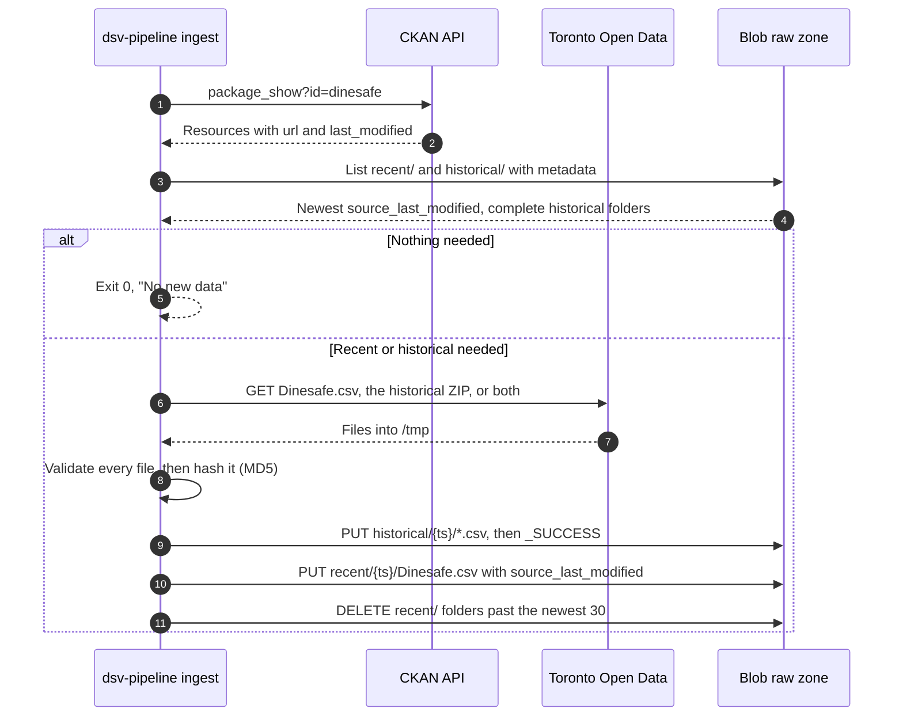

# Data ingest

This page describes how `dsv-pipeline ingest` copies files from Toronto Open
Data into the raw zone. For the overview, see
[Data architecture](3-1-data-architecture.md).

## Ingest flow

`dsv-pipeline ingest` (`src/dsv-db/data.py`) copies new files from Toronto
Open Data to the raw zone. It never touches Postgres.



| Rule                | Detail                                                                                                                                                                                    |
| ------------------- | ----------------------------------------------------------------------------------------------------------------------------------------------------------------------------------------- |
| Find files          | Exact name and format: `Dinesafe.csv` (CSV) and `Dinesafe Historical Data` (ZIP). Exactly one match each, or fail. Survives resource ID changes and skips the stale `Dinesafe™.csv`.     |
| Download recent     | CKAN `last_modified` is newer than the newest blob's `source_last_modified`, `recent/` is empty, or `--force`.                                                                            |
| Download historical | No `historical/` folder has `_SUCCESS`, or `--historical`.                                                                                                                                |
| Unzip               | Every `.csv` in the ZIP, flattened to its base name. Other files are skipped.                                                                                                             |
| Validate            | Every file, before any upload: mapped headers present, UTF-8 or cp1252, at least 50,000 recent rows and 1,000 rows per historical file. Values aren't checked.                            |
| Skip duplicates     | Doesn't upload a recent file whose MD5 matches the newest blob.                                                                                                                           |
| Upload order        | Historical CSVs, `_SUCCESS`, recent CSV, then prune.                                                                                                                                      |
| Integrity           | `Content-MD5` on every upload, so Blob rejects a corrupted body.                                                                                                                          |
| Timeouts            | 120 seconds without data, per request.                                                                                                                                                    |
| Client              | Plain Blob REST API (`x-ms-version: 2023-11-03`) with a bearer token. No Azure SDK.                                                                                                       |

### Raw zone layout

Each ingest writes to new folders. Nothing is overwritten.

```text
stdsv<env>01 / dinesafe
├── recent/
│   ├── 20261009T113005Z/Dinesafe.csv   metadata: source_last_modified
│   └── 20261012T113012Z/Dinesafe.csv   ← newest: last in sort order
└── historical/
    └── 20261005T140211Z/
        ├── dinesafe_hist_2001.csv … dinesafe_hist_2023.csv
        └── _SUCCESS                     ← written last; no marker, no load
```

- Folder name: the ingest's UTC start time, not Toronto's date. Names sort in
  time order, so there's no manifest.
- A forced download with new content gets its own folder.
- A new `historical/` folder takes effect only on the next seed. Refreshes
  never read `historical/`.
