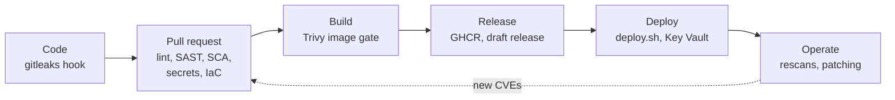

# DevSecOps

This page maps the security controls in DineSafeViz to each stage of the
delivery lifecycle, and flags the known gaps. For how the workflows run, see
[Continuous integration](4-ci.md).

## Overview

Security checks run at every stage from commit to production. Each stage
blocks only on serious, fixable problems and reports everything else to
**Security > Code scanning**. All the tools are free.

## Code

Controls that run on your machine and on the repository itself, before CI.

| Control                    | Tool                                     | Blocks?                  |
| -------------------------- | ---------------------------------------- | ------------------------ |
| Secrets in staged changes  | gitleaks (`.pre-commit-config.yaml`)     | Yes, the commit          |
| Secrets in pushes          | GitHub secret scanning + push protection | Yes, the push            |
| Changes to `main`          | `force-pr-force-checks` ruleset          | Yes, needs a PR + checks |
| History rewrites, deletion | `do-not-del` ruleset                     | Yes                      |
| Vulnerability reports      | Private vulnerability reporting          | n/a                      |

**Gaps:**

- The pre-commit hook is opt-in. Each clone needs `pre-commit install`. CI
  rescans the history, so a skipped hook fails later, at the PR.
- The Packer seed VM's SSH password is committed in
  `infra/rug/packer/ubuntu-seed.pkr.hcl`. It's accepted in `.gitleaksignore`.
- There's no `SECURITY.md` telling reporters how to report a vulnerability.
- Secret scanning for non-provider patterns is off.

## Pull request

Every PR runs these checks. The `CI` workflow's `Lint`, `Test`,
`Dependency review`, and `Build and scan` checks are required by the
ruleset, and CodeQL results are required through its code scanning rule.

| Practice         | Tool                                  | Blocks on                                     |
| ---------------- | ------------------------------------- | --------------------------------------------- |
| Lint + SAST      | Ruff with Bandit rules                | Any finding                                   |
| SAST             | CodeQL (Python, Actions)              | `high` or higher security alerts              |
| Secrets          | gitleaks, full git history            | Any finding not in `.gitleaksignore`          |
| SCA              | Dependency review                     | A new `high` or `critical` dependency         |
| IaC              | Trivy config (Terraform, Dockerfiles) | `CRITICAL` (all severities reported on push)  |
| Dockerfiles      | hadolint                              | Warnings and errors                           |
| Workflows        | actionlint, zizmor                    | Any finding                                   |
| Shell, YAML      | shellcheck, yamllint                  | Any finding                                   |
| Tests            | pytest                                | Any failure                                   |

**Gaps:**

- Trivy config doesn't scan the Packer templates, the Ansible playbooks, or
  the Compose files.
- `dsv-pipeline` runs as root (Trivy `DS-0002`, `HIGH`). It's reported, not
  blocked.
- There's no dynamic testing (DAST) against a running stack.

## Build

`ci.yml` builds each owned image, scans it, and pushes only the scanned
build.

| Practice              | Tool                                      | Blocks on                       |
| --------------------- | ----------------------------------------- | ------------------------------- |
| Image vulnerabilities | Trivy image scan                          | Fixable `CRITICAL`              |
| Pinned dependencies   | SHA-pinned actions, digest-pinned images  | n/a                             |
| Least privilege       | Per-job `permissions`, no persisted token | n/a                             |
| Smaller attack surface | `pip` removed from `dsv-pipeline`        | n/a                             |

**Gaps:**

- No SBOM, build provenance, or image signing.
- The hadolint and gitleaks images are pinned by digest outside Dependabot's
  reach, so they're bumped by hand.

## Release

A `v*` tag publishes images and the draft release, but only after lint, tests,
and both image scans pass. That holds even for a tag on a commit that never
went through a PR.

| Practice           | Tool                                  |
| ------------------ | ------------------------------------- |
| Gated publish      | `ci.yml` `publish-images` needs `lint`, `test`, and `build-scan` |
| Immutable tags     | `X.Y.Z`, `sha-<7>`, no `latest`       |
| Release notes      | Release Drafter                       |

**Gap:** nothing proves an image in GHCR came from this repository's
workflow. Attestations would close this, together with the build gap above.

## Deploy

An operator runs `scripts/deploy.sh` on the VM. CI never deploys.

| Practice              | Tool                                                     |
| --------------------- | -------------------------------------------------------- |
| Secrets at runtime    | Azure Key Vault, read by `fetch-secrets.sh` into `.env`  |
| Artifact check        | `deploy.sh` stops if either image is missing from GHCR   |
| No inbound ports      | Cloudflare Tunnel; the Compose stack publishes no ports  |
| Host hardening        | `infra/az/harden-vm.sh` (SSH keys only, ufw, sysctls)    |

**Gap:** `deploy.sh` pulls by tag and only checks that the image exists. It
doesn't verify a digest or a signature.

## Operate

Controls that keep running after a release.

| Practice                   | Tool                                               |
| -------------------------- | -------------------------------------------------- |
| New CVEs in shipped images | `rescan-images.yml`, weekly Trivy rescans to code scanning |
| New CVEs in dependencies   | Dependabot alerts and security updates             |
| Dependency freshness       | Dependabot version updates, 7-day cooldown         |
| Recurring SAST, IaC        | `code-scanning.yml`, weekly                        |
| OS patches                 | unattended-upgrades, Azure Update Manager          |

**Gaps:**

- No runtime monitoring or alerting. The containers have health checks, but
  nothing notifies you when one fails, and the inspections dashboard
  (Grafana) shows data, not system health.
- Findings below each gate are report-only. Review
  **Security > Code scanning** after each weekly rescan.
